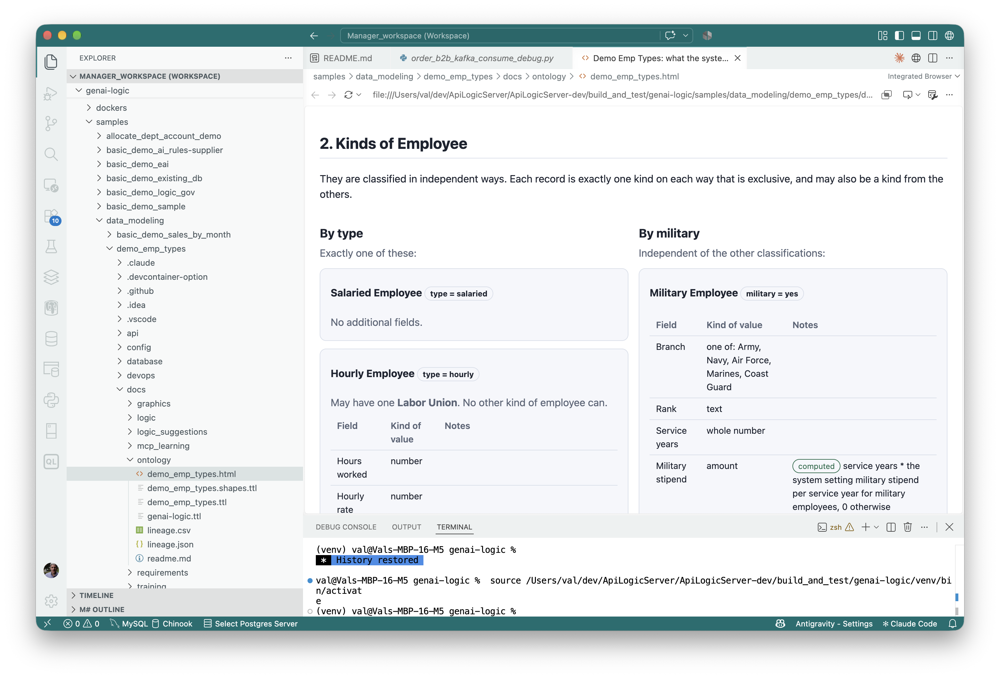

!!! pied-piper ":bulb: TL;DR - Ontology Creation"

    You can ask AI to create an Ontology.  This is a formalized meta data format useful to other tools.

     It is somewhat like a schema, but includes type information.  See, for example, the [Employee Types Sample](Sample-Types.md){:target="_blank" rel="noopener"}.

&nbsp;