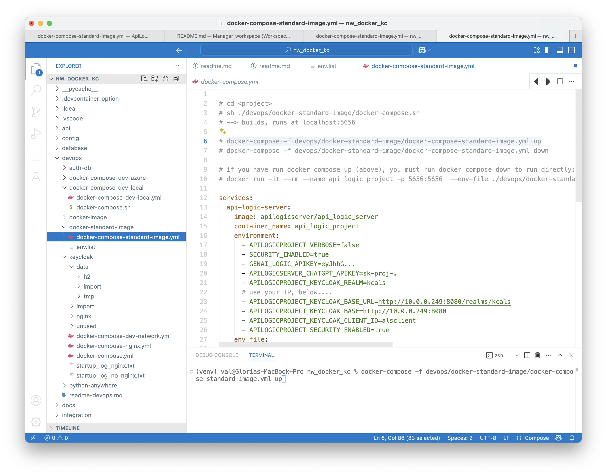

!!! pied-piper ":bulb: TL;DR - Run your project in the standard container - no build required"

    The standard image, `apilogicserver/api_logic_server`, contains Python, API Logic Server and the libraries projects use.  Mount your project folder and run it:

    ```bash
    cd <your-project>
    docker run -it --rm --name api_logic_project -p 5656:5656 -v ${PWD}:/app apilogicserver/api_logic_server python3 /app/api_logic_server_run.py
    ```

    Open `http://localhost:5656`.  Podman: type `podman` for `docker`.  New to this?  See the [DevOps Quick Start](DevOps-Quick-Start.md).

Projects include `devops/docker-standard-image/`, with a compose file and `env.list` for this:

```bash
docker compose -f devops/docker-standard-image/docker-compose-standard-image.yml up
```

Configure the server with environment variables (database URI, security, ports) in `env.list` or the compose file; see [Container Configuration](DevOps-Container-Configuration.md).



The diagram above illustrates running your project in the pre-created image, connected to other containers such as a database or Keycloak.

> Networking: a container cannot reach other containers at `localhost`.  Configure the host's IP address (or `host.docker.internal`) as shown above, or put the containers on a shared network (`docker network create dev-network`, then `--net dev-network`).

&nbsp;

## Need a package the image does not have?

The image contains the libraries used by projects (Flask, SQLAlchemy, SAFRS, LogicBank, Kafka, and drivers for PostgreSQL, MySQL, Oracle and SQL Server).  If you need another, extend the image with a short dockerfile - see [Build Project Image](DevOps-Containers-Build.md#mypkgs-containerize-packages).

&nbsp;

## Or, build your own image

To bake your project into an image you can push to a registry, see [Build Project Image](DevOps-Containers-Build.md).
