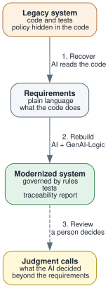

<!--
Audience: senior architects, industry analysts, dev managers.
Landing page for the Modernization section: the idea, the steps, why rules, and the two experiments.
Pages: Tech-Modernization-Automation.md (controlled sample, demo_eai), Tech-Modernization-ERPNext.md (ERPNext credit control).
-->

<style>
  .md-typeset h1,
  .md-content__button {
    display: none;
  }
</style>

# Modernization: Recover the Requirements, Rebuild as Rules

!!! pied-piper ":bulb: A rewrite buries the business policy again, in a new stack.  Recover the requirements, and rebuild using rules you can read, trust, and maintain"

    Legacy systems are opaque: business policy is buried in code written long ago.  A technology modernization (better performance, easier hiring) moves that opacity to a new stack; it doesn't remove it.  
    
    A straight AI rewrite does the same, faster.  It recovers the requirements, then buries them again in new procedural code, and the documentation drift starts over.  Governance needs to see how a system enforces policy, and needs a sound basis for evolving it.

    The alternative is two steps:

    1. Use **AI to extract the requirements** from the legacy system
    2. Use **GenAI-Logic to rebuild it as declarative rules**: spreadsheet-like statements such as `balance <= credit_limit`, run by an engine on every commit

    The rebuilt system is not only modernized, it is governed by rules you can:

    * **read:** rules are far more concise than the code they replace ([~40x in our credit-check comparison](https://github.com/ApiLogicServer/basic_demo/blob/main/logic/procedural/declarative-vs-procedural-comparison.md){:target="_blank" rel="noopener"}), and the engine manages the dependencies
    * **trust:** rules run automatically at commit time: every transaction source, every path, no bypass
    * **maintain:** rules are self-ordering, so you add a rule without execution-path archaeology and trust it will run, in the right order.  [More on why rules](Tech-Modernization-Automation.md#why-rules){:target="_blank" rel="noopener"}

    The process also produces documents for managing it:

    * The ad-libs report lists every judgment call the AI made, so a person can confirm them
    * The Requirements Traceability Report lists the extracted requirements and their rules, plus the tests the system created, and confirms which rules ran

    The rebuild covers the database, API, messaging, security, and business logic.  It does not address deployment or database migration.

    We have run this twice, on small systems.  The results are encouraging.  We have not shown that a rebuild behaves the same as the original: see [what we can and cannot say](#what-we-can-and-cannot-say).

&nbsp;

## The process

{: style="height:500px"; align=right }

Three steps:

**1. Recover.**  AI reads the legacy code and writes down what it does, in plain language: the data, the business rules, the integrations, the security.  The result is a requirements document.  It describes what the code does, which is not always what the business meant, so a person should read it.  It often records behavior nobody had written down.

**2. Rebuild.**  The requirements go to GenAI-Logic, which builds a new system from them: the database and API, messaging, declarative rules for the business logic, tests generated from the rules, logic diagrams, and a Requirements Traceability Report that shows each requirement beside the rules and tests that implement it.  The AI follows a short script, one line per task.

**3. Review.**  Wherever the requirements stopped and the AI had to decide, it records the decision in an *ad-libs* report, with the ones a person must check marked.  The more the AI infers, the more this list matters.  A person decides each item.

For more on the automated reports, see ["What did AI Build"](Tech-RTP.md){:target="_blank" rel="noopener"}.

&nbsp;

### What the script and the requirements look like

The rebuild is driven by a script like this, pasted to the AI assistant:

```
create project demo_eai_modernized from samples/dbs/basic_demo.sqlite

add security (degrade to SQL if Keycloak is not available)

implement requirements samples/requirements/demo_eai_modernize/demo_eai

verify message subscriptions (all topics)

create logic diagram for each requirement (skip if graphviz is not available)

create tests from rules, using default names

run the tests

run the requirements traceability report
```

"implement requirements" names the recovered requirements.  An excerpt:

> 4. **Customer Balance Rollup (Unshipped Orders Only)**: `Customer.balance` is recalculated as the sum of `Order.amount_total` across all **unshipped** orders (`date_shipped IS NULL`) for that customer whenever affected orders or items change, an order is reassigned to a different customer, `date_shipped` is set/cleared, or an order is deleted.
>
> 5. **Credit Limit Enforcement**: Whenever a customer's `balance` is recalculated or an existing customer's `credit_limit` is updated, the system verifies `balance <= credit_limit`.  If exceeded, `CreditError` is raised (`"{name}: balance {balance} exceeds credit limit {limit}"`), aborting the transaction.

Plain statements of behavior, with no code.  The AI turns each into rules.


*Left: the creation script.  Right: the requirements it implements, recovered from the legacy code.*

&nbsp;

## The experiments

| | [Controlled sample](Tech-Modernization-Automation.md){:target="_blank" rel="noopener"} | [ERPNext](Tech-Modernization-ERPNext.md){:target="_blank" rel="noopener"} |
|---|---|---|
| **Source** | An order-entry system AI built for the experiment, with its documents removed | The credit control in ERPNext, an open-source business application we did not write |
| **Policy** | Customer balance against a credit limit; shipping messages; partner orders | A customer's credit limit, enforced on four kinds of document with different bypass logic |
| **What it tests** | The process under controlled conditions, with a reference implementation to compare against | The process on real, unfamiliar, framework-heavy code, checked against the repository's own tests |
| **Rebuild starts from** | A sample database | An empty database: the AI designed the schema |
| **Result** | 8 rules, 35 of 35 scenarios passing, 6 decisions for review | 32 rules, 52 scenarios passing, 12 decisions for review |

Each page ends with an assessment of what that experiment does and does not show.

&nbsp;

## What we can and cannot say

It is hard to predict how this will go on your system.  The variety of legacy systems is virtually infinite: languages, frameworks, age, size, quality, how much of the policy lives in code, in the database, or in people's heads, and how well it is tested.  Two experiments tell us what happened in those two cases.  They do not tell us what to expect in yours.

What we can say:

- The process ran end to end both times, and produced a governed system: rules, tests, a traceability report, and a list of decisions for review.
- Extraction recorded behavior nobody had written down, and the review list surfaced places where the AI had guessed.
- The more the AI infers (an empty database, a vague requirement), the more the ad-libs report matters.

What we cannot say:

- That the rebuilt system behaves the same as the original.  Both experiments used the same family of AI assistants end to end, and we compared against the recovered requirements and, for ERPNext, the repository's tests by reading.  We did not run the original and the rebuild side by side.
- That it scales.  Both systems are small, and each was run once.
- That it works on old code.  Neither source is decades old.
- That it covers deployment or database migration.  Neither is addressed here.

The test we would most like to see is an older, messier codebase, recovered independently by a second model, with the results compared.  If you have one, that is the experiment worth running.

