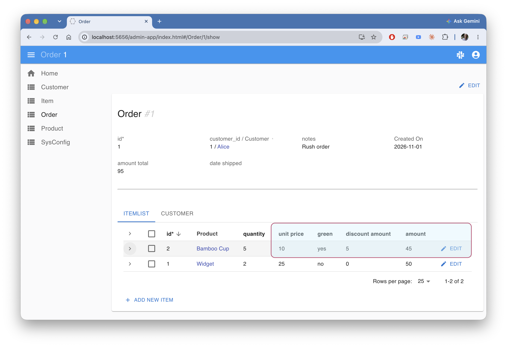
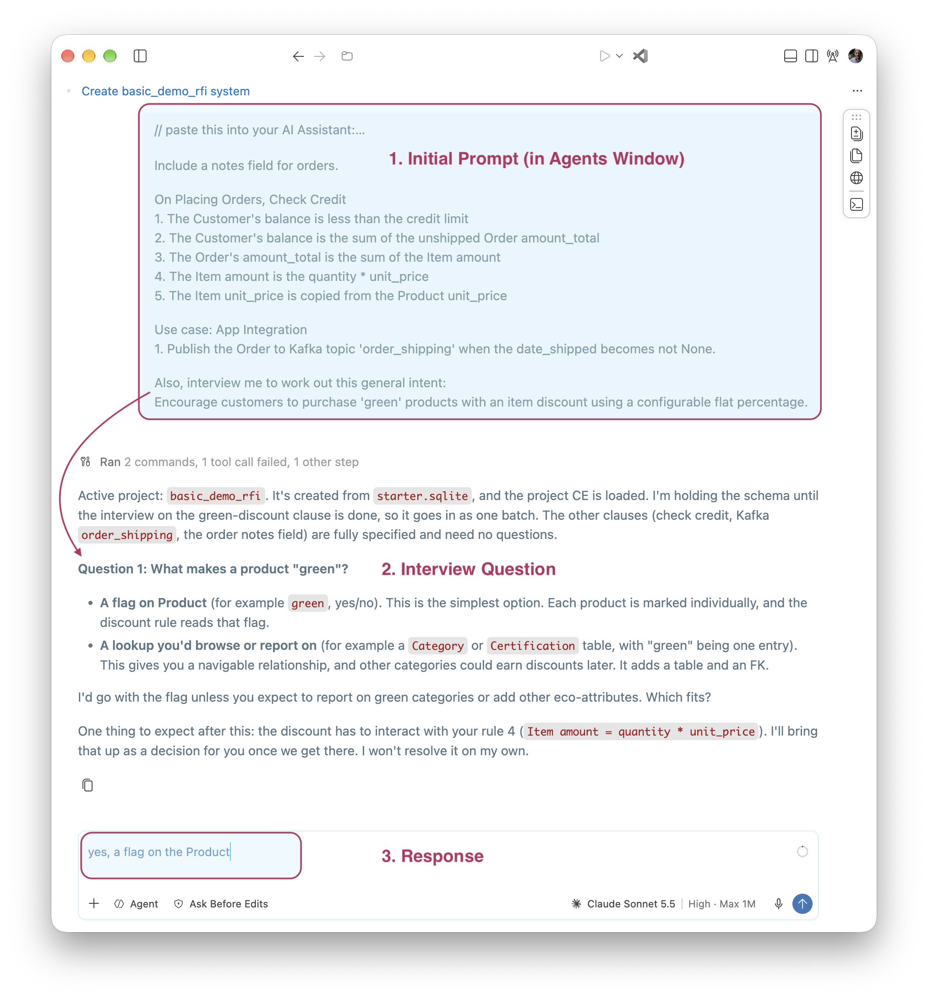

!!! pied-piper ":bulb: TL;DR - RFI: Requirements From Interview"

    This illustrates you can supply incomplete requirements, and
    request that AI *interview* you to complete them and create a system.

    Here we create the basic demo for Customer and Orders,
    and request an interview for encouraging sales of *"green"* products.

&nbsp;

## Overview

This app illustrates using IntegrationServices for B2B push-style integrations with APIs, and internal integration with messages.

&nbsp;

Observe the hilit area: data model and logic changes for "green" products.

&nbsp;

## Creation and Setup

We created this system (api, logic, admin app) as follows:

