<style>
  .md-typeset h1,
  .md-content__button {
    display: none;
  }
</style>

!!! pied-piper ":bulb: TL;DR - Kafka Integration: Async Messaging"

    APIs are useful to application integration, but do not deal with the reality that the receiving system might be down.

    Message Brokers like Kafka address this with guaranteed ***async delivery*** of messages.  The Broker stores the message, delivering it (possibly later) when the the receiver is up.

    Message Brokers also support multi-cast: you ***publish*** a message to a "topic", and other systems ***subscribe***.  This is often casually described as "pub/sub".

    This sample presumes you are familiar with basic GenAI-Logic services, as illustrated in the Basic Demo tutorial.

    **The flow this page walks through:** *Executable Requirements* (the spec is a prompt your AI executes, so the requirements build the system) → *tests* (AI writes Behave tests from the rules, and runs them) → *documentation* (a Requirements Traceability Report traces each requirement to its rules, tests and the logic that actually ran). Requirements, system, tests and docs stay connected, and each step is one sentence to your AI assistant — see [Build It](#build-it).

    > This is the same system used in [Executable Requirements](Exec-Reqmts.md){:target="_blank" rel="noopener"}, which focuses on how these prompts serve as the living spec — readable by business and IT, executable by AI.

&nbsp;

## Overview

This app illustrates using IntegrationServices for B2B push-style integrations with APIs, and internal integration with messages.

&nbsp;

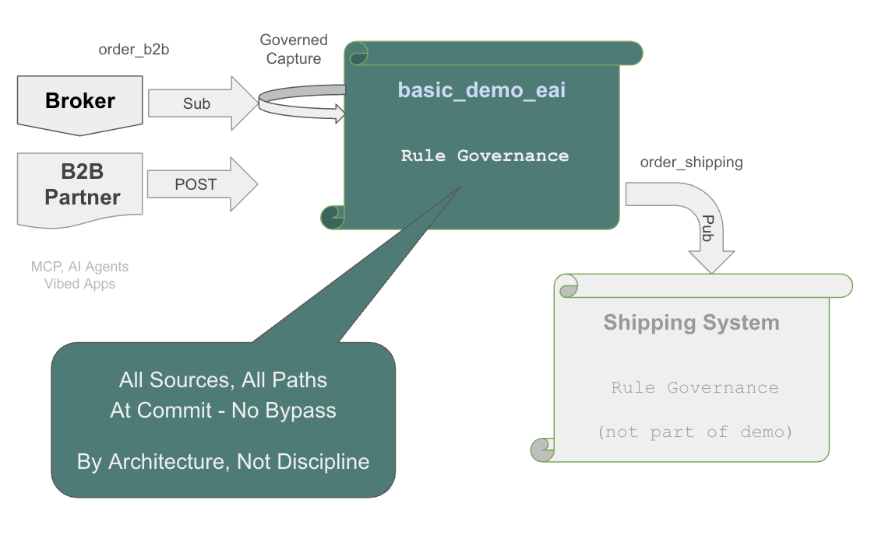

**This sample** is a single API Logic Server providing APIs *and logic* — it both
subscribes and publishes, so there's no second project to stand up:

1. **Order Logic:** enforcing database integrity (Check Credit) and application
   integration (notify shipping)

2. A **Custom API** (`OrderB2B`), matching an agreed-upon format for B2B partners

3. **Kafka Subscribe:** listens on topic `order_b2b` for inbound orders from a
   message broker

4. **Kafka Publish:** publishes to topic `order_shipping` when an order ships —
   consumed by whatever downstream shipping system you plug in (not part of this
   demo)

5. **Standard APIs** for ad-hoc integration, user interfaces, etc

6. **Operations Dashboard:** charts on the Admin App home page showing that orders
   are flowing — messages received, processed and rejected per day, and orders per day

&nbsp;

## Creation and Setup

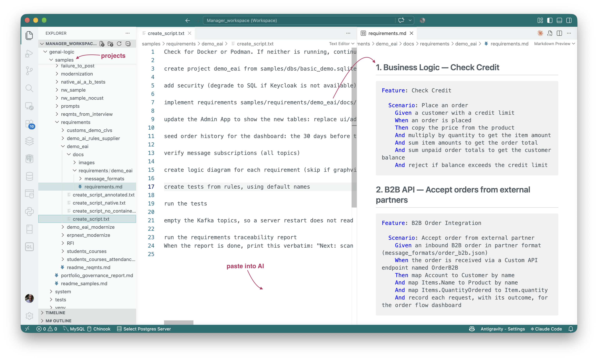

The requirements are shown at right above, truncated.  To see the entire file, [click here](https://github.com/ApiLogicServer/ApiLogicServer-src/blob/main/api_logic_server_cli/prototypes/manager/samples/requirements/demo_eai/docs/requirements/demo_eai/requirements.md){:target="_blank" rel="noopener"}.  

> This creates the executable project: **integration** (MCP-enabled API, messaging), **business logic**, and the **Admin App**.  It then creates / runs the tests, and documents it all in [this file](https://github.com/ApiLogicServer/ApiLogicServer-src/blob/main/api_logic_server_cli/prototypes/manager/samples/basic_demo_eai/docs/requirements/Requirements%20Traceability%20Report.md){:target="_blank" rel="noopener"}. This example uses Gherkin `md` file; you can also use your existing methodolgies.

&nbsp;

### Is the business flowing?

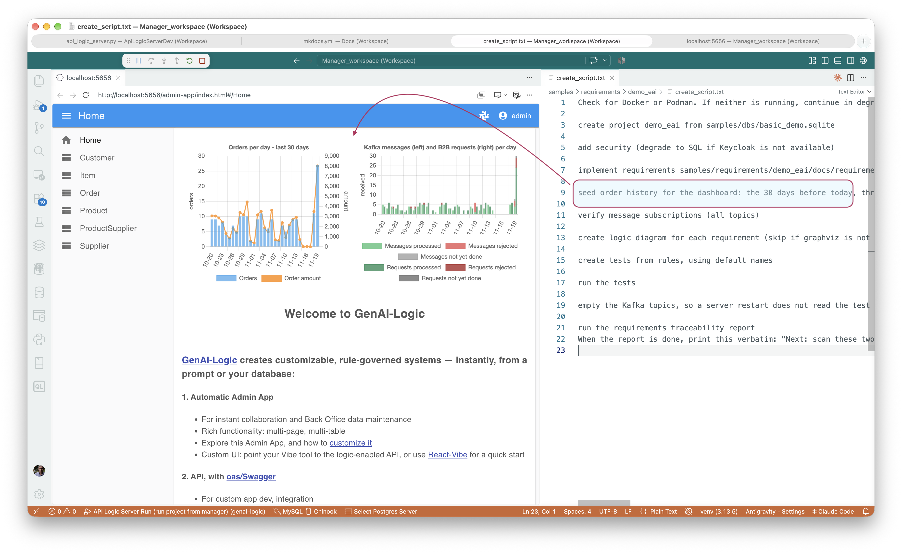

Rules keep each transaction correct. An executive also needs to know that the business is *flowing*: orders arriving,
being processed, not piling up as rejects. This sample answers that with **rules, not a reporting stack**: ten
one-line rules maintain daily totals of orders, Kafka messages and B2B requests. The totals are updated in the same
transaction, on every path (B2B API, Kafka, Admin App), so they are as trustworthy as the balances: no ETL, no
separate metrics pipeline, nothing to drift.

**None of it is hand-written.** The rules and the charts were built by your AI assistant from requirement §6, a few
lines of Gherkin (shown in Section 8), in the same `implement requirements` step as the rest of the system.

The charts are about 100 lines of glue on the Admin App home page. The totals themselves are a standard, secured API
resource (`/api/DailyFlow`), so Grafana, Power BI or a custom (Vibe) UI can show the same numbers.
*We maintain the numbers; show them anywhere.* Details in [Section 8](#8-requirement-6-operations-dashboard-order-flow).

&nbsp;

### Using Kafka

**No Kafka installed? No Docker?** Not required for any of this. The Kafka client library installs with the project either way; you only need an actual broker running if you want to see live message delivery (Section 6, Step 6 — optional).

Everything else — building, running, Check Credit, the Custom API, and even the Kafka Subscribe/Publish logic itself — works and is fully testable without one.  

If/when you do want live Kafka, the manager readme contains setup and verification instructions.  To see them, [click here](DevOps-Quick-Start.md){:target="_blank" rel="noopener"}.

**Just want to run it, skip building?** The Manager already has a pre-built `basic_demo_eai` — jump straight to [Section 1, Run and Verify](#1-run-and-verify).  Everyone — whether you just built it or you're using the pre-built copy — starts
there.

&nbsp;

## Build It

One sentence creates the project; one sentence executes **every** requirement below
(Check Credit, B2B API, Kafka Subscribe, Kafka Publish, Security, Operations Dashboard) — steps A-C are the
**entire build**, not the first of several. Step C2 seeds history for the dashboard, and steps D-H (Kafka check,
diagrams, tests, report) are optional extras that verify and document it. Here is the whole procedure, then what each step means:

> **Important:** be sure your AI assistant is in "Agent" mode ("Ask" will not work). No bootstrap prompt is needed: the Manager's context loads automatically when you open it in your AI assistant.

```text title="The entire procedure: every line is a sentence to your AI assistant, none is a shell command"
// 0 - Environment
Check for Docker or Podman. If neither is running, continue in degraded mode (SQL security, simulated Kafka) and tell me so up front.

// A - Create Project
create project demo_eai from samples/dbs/basic_demo.sqlite

// B - Security
add security (degrade to SQL if Keycloak is not available)

// C - Implement Requirements
implement requirements samples/requirements/demo_eai/docs/requirements/demo_eai

// C2 - Seed order history
seed order history for the dashboard: the 30 days before today, through the rules (not SQL), with weekday and weekend volumes, one day with mostly rejected messages, and no activity 3 and 2 days ago

// D - Verify Kafka
verify message subscriptions (all topics)

// E - Logic Diagrams
create logic diagram for each requirement (skip if graphviz is not available)

// F - Create Tests
create tests from rules, using default names

// G - Run Tests
run the tests

// H - Traceability Report
run the requirements traceability report
When the report is done, print this verbatim: "Next: scan these two files: logic/logic_discovery/check_credit.py (the rules) and docs/requirements/demo_eai/ad-libs.md (the judgment calls the AI made). Then open the report: demo_eai/docs/requirements/Requirements Traceability Report.md (in VS Code: open the file, then Cmd/Ctrl+Shift+V for the rendered preview)."
```

**Running it:** start your AI assistant (Claude Code, for example) in the Manager folder and paste the block, or paste [`create_script.txt`](https://github.com/ApiLogicServer/ApiLogicServer-src/blob/main/api_logic_server_cli/prototypes/manager/samples/requirements/demo_eai/create_script.txt), which is the same script, with [each step explained](https://github.com/ApiLogicServer/ApiLogicServer-src/blob/main/api_logic_server_cli/prototypes/manager/samples/requirements/demo_eai/create_script_annotated.txt). Lines starting with `//` are notes for you; the assistant ignores them. The first steps run from the Manager root; later ones (tests, report) use triggers that live in the created project's context (`demo_eai/.github/copilot-instructions.md`). If the assistant does not recognise one, open `demo_eai` as the workspace.

**Using Podman instead of Docker?** Nothing to change: the script uses `podman compose` when only Podman is running. One-time setup: see
[DevOps-Podman](DevOps-Podman.md).

**No Docker or Podman?** The script notices, tells you up front, and carries on in degraded mode (it does not stop). To choose that mode even when a runtime is installed, paste [`create_script_no_container.txt`](https://github.com/ApiLogicServer/ApiLogicServer-src/blob/main/api_logic_server_cli/prototypes/manager/samples/requirements/demo_eai/create_script_no_container.txt) instead: the same script with a different first line. Degraded mode builds the same system from the same requirements, with two differences:

* **Security** uses the SQL authentication provider (no Keycloak), and Row-Level Security is still tested.
* **Kafka** runs in fallback mode (`KAFKA_SERVER` unset). Subscribe is tested through the debug endpoint,
  `/consume_debug/order_b2b`, which runs the same parse-and-save function the live consumer uses; the report labels
  those scenarios *simulated*. Live Kafka delivery is not verified in this mode. Start a broker and set `KAFKA_SERVER`
  and `KAFKA_CONSUMER_GROUP`, and the same endpoint publishes through the broker and the same tests run live.


&nbsp;

### What the steps mean

| Step | What it does |
|---|---|
| **0 - Environment** | Your assistant checks for Docker or Podman. With neither running it says so up front and continues in degraded mode (SQL security, Kafka tested through the debug endpoint). |
| **A - Create Project** | Creates a working, MCP-enabled API and Admin App from the existing database (and the `genai-logic` CLI to manage it). No logic yet. |
| **B - Security** | Keycloak when a container runtime is running, else the SQL authentication provider that ships in the project, so the row-level security requirement (§5) is enforced either way. You are told which was used. |
| **C - Implement Requirements** | The build: the requirements (6 Gherkin features, plus the message formats) are copied into the project, and your AI assistant writes the rules, the Custom API, the Kafka subscribe and publish, the security declarations, and the dashboard. It also writes `ad-libs.md`, the judgment calls it made, for you to review (the closing message points you at it). Sections 2-5b, 7 and 8 below tour what it produced. |
| **C2 - Seed Order History** | Gives the dashboard 30 days of history to chart (Section 8). A script run inside the app writes the orders and message rows through the ORM with the rules active, so every amount, total and balance is derived and the credit limit checked. It does **not** go through the B2B API or Kafka: the mapper, the consumers and their error recording are exercised by the tests (step F), not by the seed. Deterministic: a rebuild draws the same picture. |
| **D - Verify Kafka** | With a broker running: enables live Kafka, resets the topics first (messages left by earlier runs would otherwise be replayed), sends the sample message, and confirms a processed blob and a new order. With no broker it verifies the simulated path and says so. |
| **E - Logic Diagrams** | Draws the rule chain for each requirement as an SVG; the report shows each one under its requirement. Skipped with a one-line note if graphviz is missing. |
| **F - Create Tests** | Writes Behave scenarios from the rules. "Default names" means each Feature is named exactly as its requirement, so the report can show, per requirement, which tests exercised it. |
| **G - Run Tests** | Starts the server if needed, runs the scenarios against the live API, records the logic log for each, and stops the server it started. |
| **H - Traceability Report** | Writes the report, `demo_eai/docs/requirements/Requirements Traceability Report.md`. **Open it** (VS Code: open the file, then Cmd/Ctrl+Shift+V for the rendered preview): requirements traced to rules, tests and logic. |

* Steps D-H are each optional, and H works without the others (run it right after C for everything except test results).
* The *Row-Level Security* scenarios are exercised in both modes: step B turns security on with Keycloak or with the SQL provider.
* A scenario that reads a message back from the `order_shipping` topic needs a live broker (Section 6, Step 6); every other scenario runs with no Kafka.
* The full requirements spec that step C executes is
  [docs/requirements/demo_eai/requirements.md](https://github.com/ApiLogicServer/ApiLogicServer-src/blob/main/api_logic_server_cli/prototypes/manager/samples/requirements/demo_eai/docs/requirements/demo_eai/requirements.md).
  **Sections 2-5b, 7 and 8 below are a tour of what step C built** — each maps back to the requirement that produced it. They are not additional steps to run.

This is a real project: your IDE, your Python, your source control. The prompt creates it in minutes — but you own it fully and iterate from there. Change a rule; the engine determines execution order automatically. Add an endpoint; the rules are already there waiting for it.

This suggests a different way to think about requirements gathering. Instead of Word documents that describe a system and then drift from it, requirements can be structured prompts — precise enough for AI to execute, readable enough for business and IT to agree on. The spec and the running system are the same artifact.

&nbsp;

## 1. Run and Verify

1. **Start the Server:** F5 (or `python api_logic_server_run.py`)
2. **Start the Admin App:** browse to [http://localhost:5656/](http://localhost:5656/).  The Admin App screen shown below should appear in your Browser.
3. **Verify as shown below**

<details markdown>

<summary> Your project includes a data model diagram</summary>

<br>

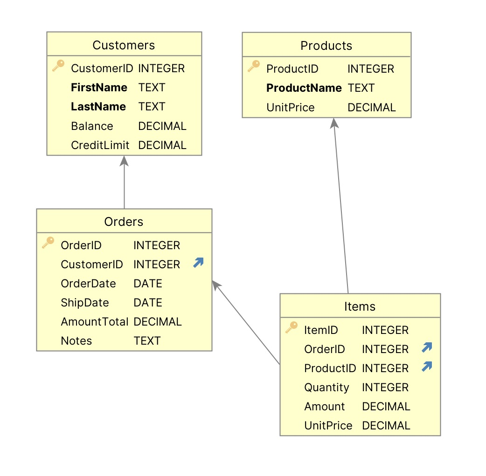

</details markdown>

&nbsp;

<details markdown>

<summary>API: filtering, sorting, pagination, optimistic locking,related data access... see Swagger </summary>

Your API is MCP enabled, and ready for custom app dev.  For more information, [click here](API-Self-Serve.md){:target="_blank" rel="noopener"}.

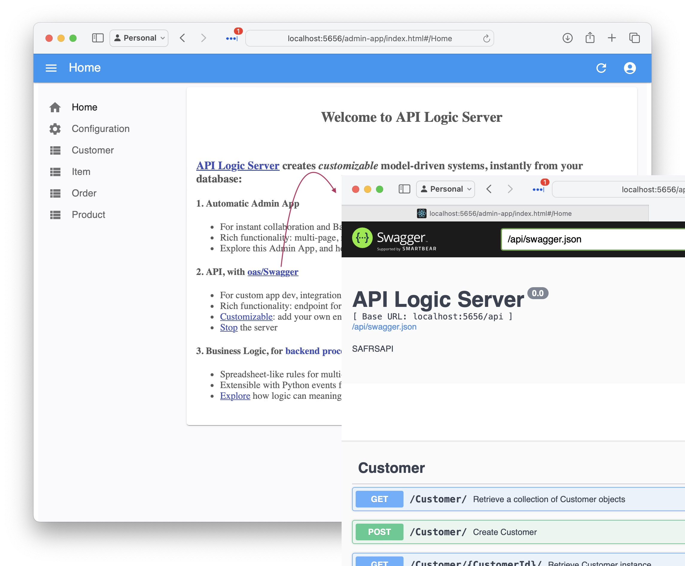
</details>

<br>

<details markdown>

<summary>Admin App: multi-page, multi-table, automatic joins, lookups, cascade add - collaboration-ready</summary>

For more information, [click here](Admin-Tour.md){:target="_blank" rel="noopener"}.

The Admin App is ready for **[business user agile collaboration](https://apilogicserver.github.io/Docs/Tech-AI/),** and back office data maintenance.  This complements custom UIs created with the API.

Explore the app - click Customer Alice, and see their Orders, and Items.  

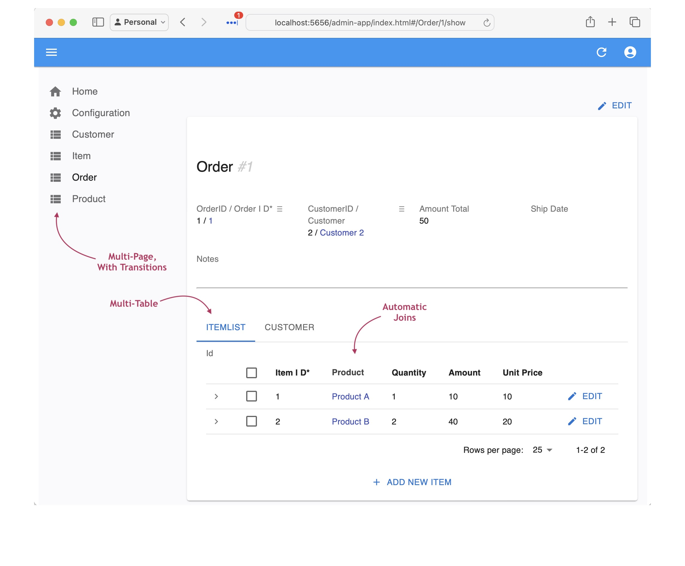
</details>

Now go to [Section 6, How to Test](#6-how-to-test) to exercise the EAI features
(Check Credit, Kafka Subscribe, Kafka Publish) — or continue reading below for a
tour of how each requirement became the running system you just verified.

<br>

## 2. Requirement §1 — Check Credit Logic

Logic (multi-table derivations and constraints) is a significant portion of a system, typically nearly half.  GenAI-Logic provides **spreadsheet-like rules** that dramatically simplify and accelerate logic development.

`implement requirements` turned this Gherkin feature (requirements.md §1) into the 5 rules below — no procedural code to write or maintain:

```bash title="Check Credit Logic (instead of 220 lines of code)"
On Placing Orders, Check Credit    
    1. The Customer's balance is less than the credit limit
    2. The Customer's balance is the sum of the Order amount_total where date_shipped is null
    3. The Order's amount_total is the sum of the Item amount
    4. The Item amount is the quantity * unit_price
    5. The Item unit_price is copied from the Product unit_price

Use case: App Integration
    1. Send the Order to Kafka topic 'order_shipping' if the date_shipped is not None.
```

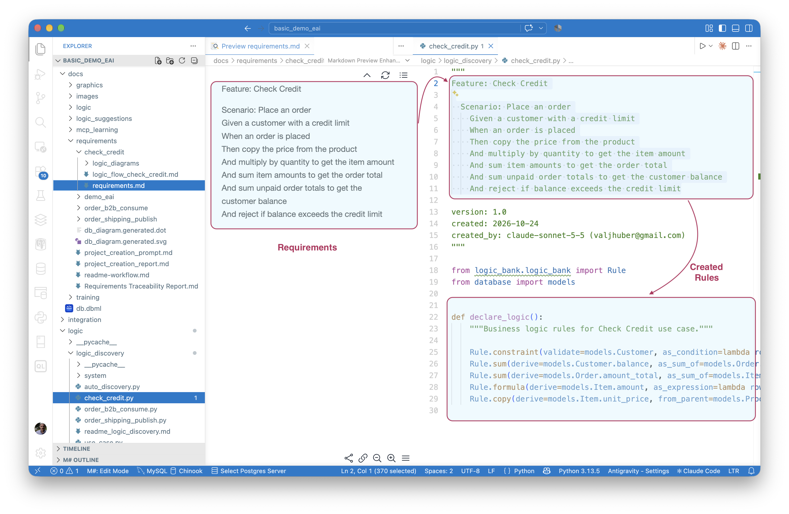

> **These rules are declared once, on the data — not once per entry point.** LogicBank hooks
> the database commit itself, so Check Credit fires on *every* write path that touches an
> Order or Item: the Admin App, the standard JSON:API, the `OrderB2B` custom API (Section 4),
> and the Kafka subscriber (Section 5) — all four call the same rules, automatically. Nothing
> downstream has to (or even can) re-request "enforce Check Credit here too" — that's not a
> phrase you'll find in this project's requirements.md.

<br>

## 3. Message Formats — Already Included

AI generates integrations **by example** — provide a sample message shape and it auto-maps obvious field names silently, lists exceptions you specify, and blocks server start on anything unresolvable.  They double as test fixtures.

`implement requirements` already produced these in `integration/kafka/message_formats/`
(referenced by requirements.md §2-4):

- `order_b2b.json` — inbound B2B order format
- `order_shipping.json` — outbound shipping notification format

> See [Integration EAI](Integration-EAI.md#ai-based-creation){:target="_blank" rel="noopener"} for how AI uses these.

> **Tip — mappings belong here too.**  If you have complex or non-obvious field mappings, save them alongside the format file — in any structure that's clear to you and AI: a CSV, a plain-text table, extra comments in the JSON.  AI will read whatever you reference in the prompt.  Keeping mappings here (rather than embedded in the prompt) means they're versioned, reusable, and self-documenting.

&nbsp;

<br>

## 4. Requirement §2 — Custom API for B2B Orders

To fit our system into the Value Chain, requirements.md §2 asked for a **Custom API**
to accept orders from B2B partners. `implement requirements` built the endpoint below
from this Gherkin feature:

``` bash title="Requirement §2 — B2B Order Integration"
Feature: B2B Order Integration

  Scenario: Accept order from external partner
    Given an inbound B2B order in partner format (message_formats/order_b2b.json)
    When the order is received via a Custom API endpoint named OrderB2B
    Then map Account to Customer by name
    And map Items.Name to Product by name
    And map Items.QuantityOrdered to Item.quantity
```

Result: `POST /api/OrderB2B` — see Section 6 to test it. Note there's no clause here
about enforcing Check Credit — see Section 2's callout for why not.

<br>

## 5. Requirement §3 — EAI Subscribe (Inbound Kafka Message)

requirements.md §3 asked for the same B2B order shape, but arriving via Kafka instead
of a direct API call — reusing the message format from Section 3:

```text title="Requirement §3 — Kafka Subscribe Order Integration"
Feature: Kafka Subscribe Order Integration

  Scenario: Accept inbound orders from sales channel
    Given an inbound order message in JSON format (message_formats/order_b2b.json)
    When the message is received from Kafka topic order_b2b
    Then map Account to Customer by name
    And map Items.Name to Product by name
    And map Items.QuantityOrdered to Item.quantity
```

> **Notice what this requirement does *not* say.** It doesn't mention the 2-message
> pattern, a blob table, error capture, or Check Credit — none of that is a decision
> left to whoever writes the requirement. The EAI-consume Context Engineering treats
> the 2-message pattern (raw payload saved first, parsed second) as mandatory for
> every Kafka subscriber it builds — "single-transaction consumers cause data loss"
> — and, just as mandatory, requires that a failed parse/lookup/constraint records
> *why* on the blob row (`error_text`), not only in a server log. Both are structural
> guarantees of how this platform builds Kafka subscribers, not something this
> requirement asked for. See **What Got Built** below for what that produces.

&nbsp;

## 5a. Lookups

These mappings include **FK lookups** — `Account` isn't a column, it's a search key to find the right `Customer` row.  AI can't infer that from field names alone.  For publish (Section 7), the mappings are purely name-matching between the format file and `models.py` — something AI can do itself.

&nbsp;

<details markdown>

<summary>What Got Built?  The 2-Message Pattern</summary>

**Two-Message Pattern**

A single-transaction consumer loses data if parsing fails mid-flush — the raw payload is gone. Instead:

```
topic: order_b2b
  → Consumer 1:  save raw JSON blob → OrderB2bMessage  (Tx 1 — always commits)
  → row_event:   blob insert → publish to order_b2b_processed
  → Consumer 2:  parse → Order + Items, resolve FKs, LogicBank rules  (Tx 2)
```

Parse or business-rule failures leave `is_processed = False` on the blob row —
queryable and retryable — **and** write the failure reason to `error_text` on that
same row, so you can tell *why* a message is stuck without cross-referencing server
logs: `SELECT id, error_text FROM order_b2b_message WHERE is_processed = 0`. Neither
of these — the 2-message split or the error capture — is something this project's
requirements.md asked for; both are how this platform builds every Kafka subscriber.

**Key Files**

See the module docstring in [integration/kafka/kafka_subscribe_discovery/order_b2b.py](../integration/kafka/kafka_subscribe_discovery/order_b2b.py) for design details, field mapping, and test instructions. Supporting files:

| File | Role |
|------|------|
| `logic/logic_discovery/order_b2b_consume.py` | `row_event` bridge — publishes blob to `order_b2b_processed` (no inline parse) |
| `integration/OrderB2bMapper.py` | JSON → Order + Items (3-tier mapping contract) |
| `api/api_discovery/order_b2b_consume_debug.py` | `/consume_debug/order_b2b` — test without Kafka |
| `integration/kafka/message_formats/order_b2b.json` | Message format spec / test fixture |
| `integration/kafka/order_b2b_reset.sh` | Reset Kafka topics + log between runs |

**Quick Test (no Kafka needed)**

```bash
curl 'http://localhost:5656/consume_debug/order_b2b?file=integration/kafka/message_formats/order_b2b.json'
```

</details>

<br>

## 5b. Requirement §5 — Security

requirements.md also includes a row-level security requirement, applied the same way
as any other:

```text title="Requirement §5 — Row-Level Security"
Feature: Row-Level Security
  Scenario: Sales role sees limited customers
    Given a user with the sales role
    When querying the Customer list
    Then only return customers where credit_limit >= 3000 or balance > 0
```

This is why the requirements above included an *optional* `add-auth` step — security
only activates once auth is configured; skip it and the rest of the system still runs.

<br>

## 6. How to Test

> **Kafka is optional during development.** The server doesn't require a broker to
> start or run — this is deliberate, so you can build and test the full system with
> zero infrastructure.
>
> * **Subscribe side:** exercised with no broker at all via the `consume_debug`
>   endpoint (`APILOGICPROJECT_CONSUME_DEBUG=true`, on by default) — same code path
>   as live Kafka, just triggered by a curl instead of a topic message.
> * **Publish side:** if no broker is reachable at `localhost:9092`, the publish
>   call still completes the underlying transaction — it buffers the message, waits
>   up to ~10s for the broker, then logs a delivery failure. Nothing crashes; that
>   PATCH will just feel a little slow. That's the timeout you're seeing, not a bug.
>
> Bring up Kafka only when you want to verify the wire-level integration (Step 6
> below).

**1. Start the server:** F5 (or `python api_logic_server_run.py`)

**2. Admin App:** browse to [http://localhost:5656/](http://localhost:5656/) — click
Customer Alice, see Orders and Items.

**3. Check Credit — no Kafka needed:**
```bash title="Check Credit — no Kafka needed"
# Good order
curl -X POST http://localhost:5656/api/OrderB2B \
  -H "Content-Type: application/json" \
  -d '{"Account":"Alice","Notes":"test","Items":[{"Name":"Widget","QuantityOrdered":1}]}'

# Over-limit order — expect 400, "balance exceeds credit limit"
curl -X POST http://localhost:5656/api/OrderB2B \
  -H "Content-Type: application/json" \
  -d '{"Account":"Alice","Notes":"over limit","Items":[{"Name":"Widget","QuantityOrdered":50}]}'
```

**4. Kafka Subscribe — no live Kafka needed:**
```bash title="Kafka Subscribe — no live Kafka needed"
curl "http://localhost:5656/consume_debug/order_b2b?file=integration/kafka/message_formats/order_b2b.json"
```
Verify: `sqlite3 database/db.sqlite "SELECT * FROM 'order' ORDER BY id DESC LIMIT 1; SELECT * FROM item ORDER BY id DESC LIMIT 3;"`

**5. Kafka Publish:** PATCH an order's `date_shipped` (e.g. via the Admin App, or
the API) and watch the log — `publish_kafka_message: delivered to topic
'order_shipping'` if a broker is up, or a delivery-failure log after ~10s if not
(see callout above — expected either way).

**6. (Optional) Live Kafka, end-to-end:**

  1. Start Kafka. If the `broker1` container already exists (`podman ps -a`, from the Manager README's *Containers* section), just make sure it is running and skip the compose file: it would fail on the name. Otherwise: `docker compose -f integration/kafka/dockercompose_start_kafka.yml up -d`
     (Podman instead of Docker? Use `podman compose` — same file, unchanged. See [DevOps-Podman](DevOps-Podman.md).)
  2. Reset topics: `bash integration/kafka/order_b2b_reset.sh`
  3. Restart the server (after Docker/Podman is up, so it picks up Kafka env vars and subscribes to topics)
  4. Publish a real message to `order_b2b` and confirm it's consumed — same
     verification query as Step 4.


<br>

## 7. Requirement §4 — Publish (By-Example, Outbound Kafka)

A **key-only** publish rule sends just `{"id": 42}` — a notification that tells the
consumer to call back for current data. requirements.md §4 asked for more: a
**by-example** publish that carries the full shape the consumer needs, so it never
has to call back. `implement requirements` built this directly — no separate
"upgrade" step:

```text title="Requirement §4 — Kafka Publish Shipping Notification"
Feature: Kafka Publish Shipping Notification

  Scenario: Notify shipping when an order is dispatched
    Given an Order exists
    When date_shipped is set
    Then publish to Kafka topic order_shipping
    And use message_formats/order_shipping.json as the message shape
    And use by-example publish rather than key-only publish
```

AI reads the format file and `models.py` and maps by name.  Direct matches are silent; uncertain ones get `# TODO: verify` in `FIELD_EXCEPTIONS`; anything unresolvable is added to `_unresolved` and **blocks server start** — reported to you in chat immediately.

For full details and generated code examples, see [Integration EAI — Publish](Integration-EAI.md#publish--outbound-kafka-messages){:target="_blank" rel="noopener"}.


<br>

## 8. Requirement §6 — Operations Dashboard (Order Flow)

Requirement §6 asks: *is the business flowing?* Orders arriving, being processed, and not piling up as rejects. The
usual answer is a reporting stack: queries or a scheduled job feed a metrics store, and a dashboard reads it. This
sample answers with **more rules**, generated from the requirement below, not hand-coded. The daily totals are
derived like any other value, so the dashboard only reads them. This is the result, after the build and the seed step (C2):


The left chart is orders per day (count and amount). The right chart is, per day, the `order_b2b` Kafka messages and
the B2B API requests: processed, rejected, and not yet done. The seeded history shows what an operator looks for: a
**bad-data day** (messages keep arriving, but most are rejected) and the **flow stopping** (two days with no activity),
then recovery.

**Why rules, not a reporting stack:**

| | Reporting stack (queries, jobs, metrics store) | Rules (this sample) |
|---|---|---|
| **When the totals change** | On a schedule, or by re-querying each time the page opens | In the transaction that changes the data |
| **Which writes are counted** | Whatever the query or job reads | Every write path: B2B API, Kafka, Admin App, and any path added later |
| **Cost per change** | Re-scans the rows | Adjusts the day's total by the change (one row, no scan) |
| **Can it drift?** | A copy can lag or diverge from the data | No: same engine and same commit as the customer balances |
| **What you write** | Queries, jobs, a pipeline to run them | Ten one-line rules |

The flow numbers get the same guarantee as the balances: an order that commits is counted, and one that rolls back is
not, on every path.

**Show them anywhere.** The Admin App charts are one consumer of the totals, not the product. `DailyFlow` is a
standard API resource (`/api/DailyFlow`), with the same security, filtering and sorting as every table. Grafana,
Power BI or a custom (Vibe) UI can show the same numbers, and an alert can watch them. *We maintain the numbers; show
them anywhere.*

<details markdown>

<summary>The requirement</summary>

<br>

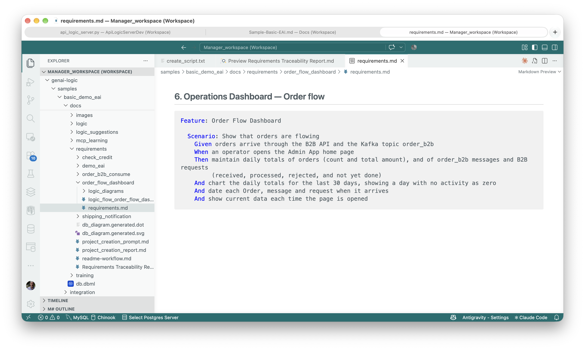

Requirement §2 adds one clause the dashboard depends on: *record each request, with its outcome* — so a rejected
B2B request leaves a row to count, not just an HTTP 400.

</details>

<details markdown>

<summary>The rules: daily totals, maintained by the engine (note use of insert_parent)</summary>

<br>

The `insert_parent` argument directs the engine to create parents on sum/count adjustment.

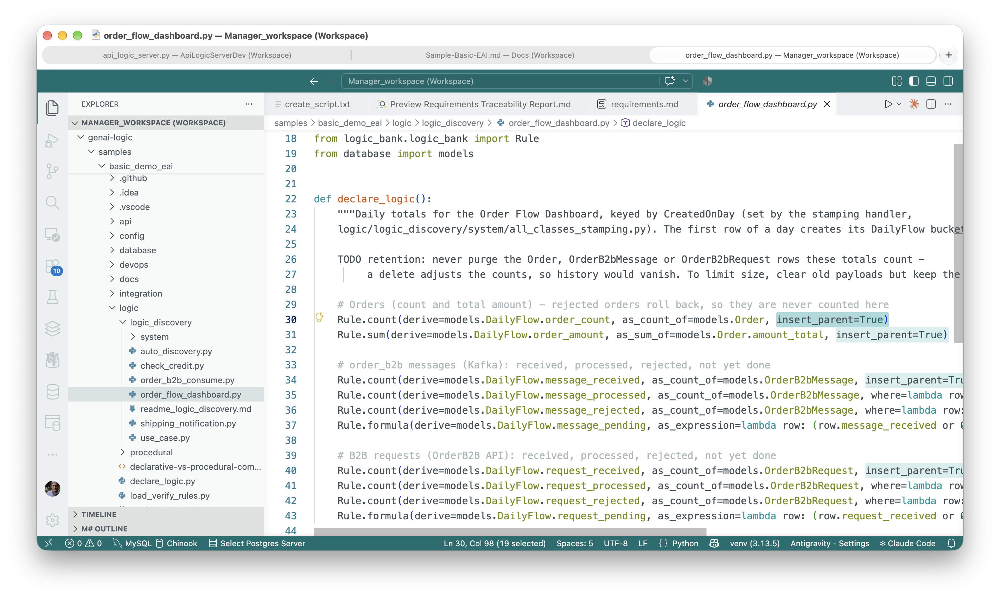

The totals are not computed when the page opens; they are **rules**, kept current on every transaction, like any
other derived value:

* **One row per day** (`DailyFlow`), keyed by the day each Order, message and request arrived (`CreatedOnDay`, set by
  date stamping).
* **`insert_parent=True`**: the first arrival of a day creates that day's row; every later one adjusts it. Nothing
  pre-creates days.
* **Counts and sums** of each kind of arrival, with `where=` for processed and rejected; **not yet done** is a
  formula: received − processed − rejected.
* **Every write path counts**: the B2B API, the Kafka consumers and the Admin App all go through the same rules.
  A failed message or request records its reason (`error_text`) through the same governed session, so the rules
  count the rejection.

The page only reads `DailyFlow` (`api/api_discovery/dashboard_services.py`), fills a day with no row as zero (so the
chart can show the flow stopping), and renders on every request, not cached.

</details>

<details markdown>

<summary>The logic diagram</summary>

<br>

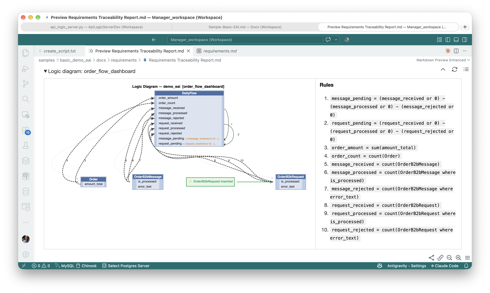

From the Requirements Traceability Report: each arrow is a numbered rule, from the arriving rows (Order,
OrderB2bMessage, OrderB2bRequest) to the day's totals.

</details>

<details markdown>

<summary>The page: how the totals reach the screen</summary>

<br>

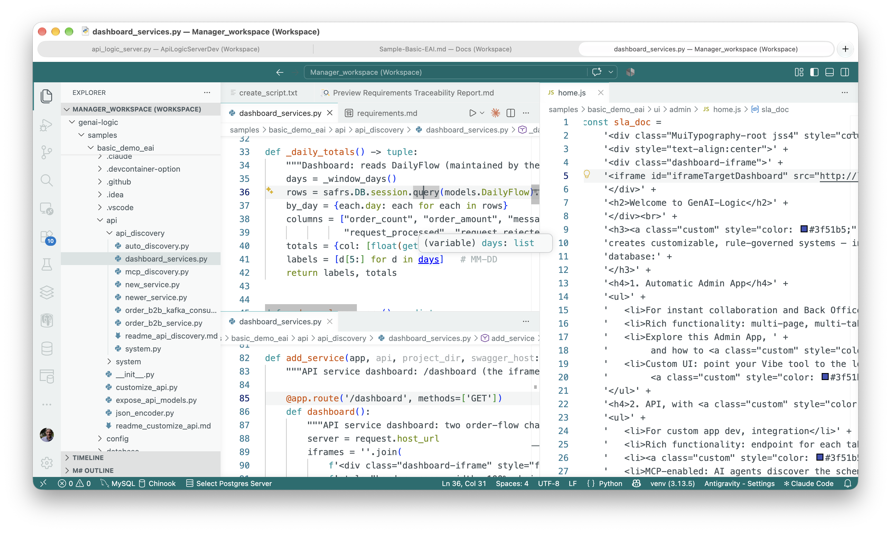

The rules are the easy part; getting the totals onto the home page takes five hops:

1. **`ui/admin/home.js`**: the Admin App home page is a fixed HTML string, so it holds one `<iframe>` pointing at `/dashboard`.
2. **`/dashboard`** returns one iframe per chart.
3. **`/chart_graphics/<name>`** calls that chart's function, listed in `CHARTS`.
4. **The chart function** (for example `order_volume_query()`) reads the `DailyFlow` rows, fills quiet days with zeros, and returns a plain dict.
5. **`ui/templates/multi_series_chart.jinja`** writes the dict into a page that draws it with Chart.js.

Hops 2-4 are in `api/api_discovery/dashboard_services.py`. To add a chart, add a function and a `CHARTS` entry;
`home.js` does not change. The project's `api/api_discovery/dashboard_services_readme.md` explains why each hop
exists, the dict the template expects, and what to add for production (a login).

</details>

**Where the history comes from: step C2, and what it is not.** A new project has only today's test data, so the
charts would be one spike at the right edge. Step C2 seeds the 30 days before today
(`database/test_data/seed_order_flow.py`). The seed writes through the ORM inside the app with the rules active:
every item price and amount, order total, customer balance and daily total is derived by the rules, and the credit
limit is checked. It is **not** delivered through the B2B API or Kafka: the seeded messages and requests are written
already processed (or rejected, with an error text the seed supplies). The tests (step F) exercise the real API and the
real topic. The seed is deterministic (fixed random seed, dates relative to today) and refuses to run twice.

> **Retention:** order, message and request rows are never purged. The totals count them, so deleting rows would
> lower past days' totals. The logic file carries a TODO with the options.

> **Live Kafka and restarts:** the consumer commits its offsets, so a restart does not read old messages again
> (`APILOGICPROJECT_KAFKA_COMMIT_OFFSETS`, on by default; see `config/default.env`). The create script empties the
> topics after the tests, so the test messages are not replayed into a later demo.

For how to ask your AI assistant for queries and dashboards in your own project, see
[Admin Customization — AI Assistant](Admin-Customization.md#ai-assistant){:target="_blank" rel="noopener"}.
