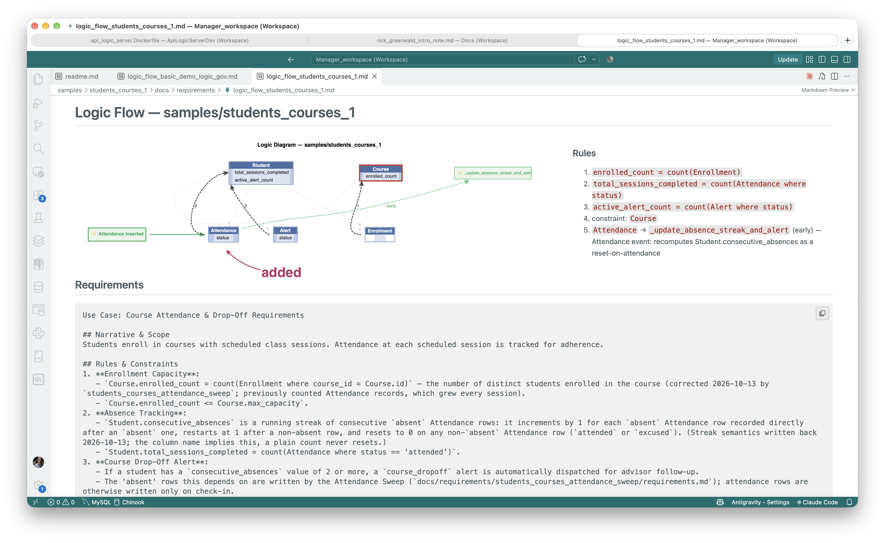
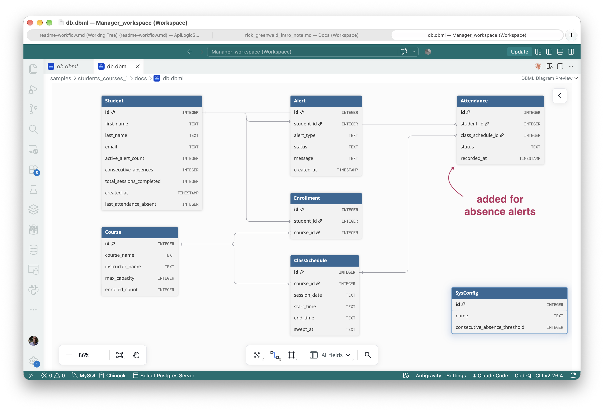
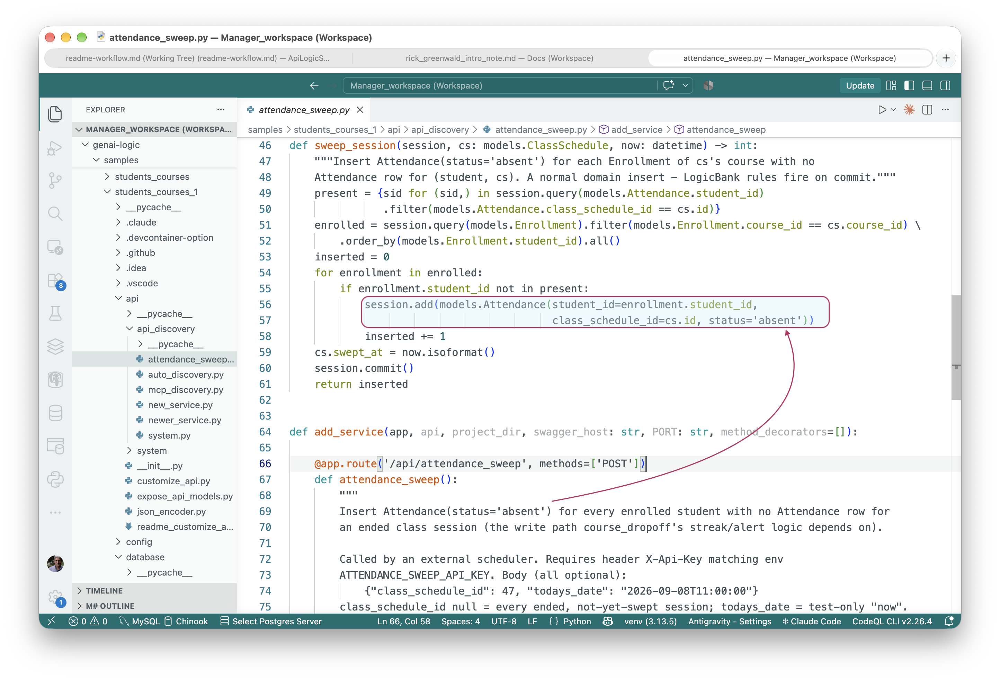

<style>
  .md-typeset h1,
  .md-content__button {
    display: none;
  }
</style>

!!! pied-piper ":bulb: TL;DR - When the CE correctly refuses to guess, and what resolving it later looks like"

* **`students_courses`** — a course-attendance requirement with two traps a literal
  reading won't reveal: a column named `consecutive_absences` whose own requirement text
  says `count(...)` (a plain count never resets — it needs a streak, not a tally), and a
  Course Drop-Off Alert that depends on an `Attendance(status='absent')` row that nothing
  in the system ever writes. The CE catches both unaided: the streak gets built correctly,
  and the alert logic is left commented out with a `FIXME` rather than guessing a trigger
  mechanism it was never asked to invent.
* **`students_courses_1`** — the same project, carried one phase further. A second
  Executable Requirements pass supplies the missing design decision (an externally
  triggered sweep endpoint, suited to a clustered deployment, plus an `Enrollment` table
  the sweep needs to know who was expected) and turns the `FIXME` into working code.

# Students & Courses

A two-phase example of the Executable Requirements workflow: the first phase shows the CE
correctly identifying that a requirement depends on a design decision it hasn't been given,
and the second phase shows what happens once that decision arrives.

Business rules fire on a write. If you need to find out that *nothing happened*, rules are not
a direct solution — but they can help, once something outside the rules supplies the missing
row.

## Phase 1 — `students_courses`: correctly blocked

This was a deliberate stress test: the requirement was written *without* saying how absences
are detected, to check that the AI does not act presumptuously.

```
1. Enrollment Capacity:
   - Course.enrolled_count = count(Attendance where status in ('attended', 'excused'))
   - Course.enrolled_count <= Course.max_capacity
2. Absence Tracking:
   - Student.consecutive_absences = count(Attendance where status == 'absent')
   - Student.total_sessions_completed = count(Attendance where status == 'attended')
3. Course Drop-Off Alert:
   - If a student has a consecutive_absences value of 2 or more, a course_dropoff alert
     is automatically dispatched for advisor follow-up.
```

It reads naturally, and hides three traps:

- **Count vs. streak.** `consecutive_absences` is written as a `count(...)`, but the name
  promises an unbroken current run. A plain count never resets.
- **Absence of an event.** Nothing says what writes an `absent` row when a student simply
  doesn't show up — a missed class is a non-event, and no rule engine can fire on a row that
  never arrives.
- **`enrolled_count` counts the wrong thing.** Counting Attendance rows grows with every
  session; it is not the number of enrolled students.

Rather than invent a trigger mechanism unprompted, the implementation leaves the streak/alert
logic commented out with a `FIXME`, and files the gap — with candidate strategies, not a
silent pick — in its own `ad-libs.md`.

[Full report](https://github.com/ApiLogicServer/ApiLogicServer-src/blob/main/api_logic_server_cli/prototypes/manager/samples/students_courses/docs/requirements/course_dropoff/ad-libs.md)

## Phase 2 — `students_courses_1`: resolved

Given the missing decision — a scheduled reconciliation job, triggered externally rather
than by an in-process timer (so a clustered deployment never races multiple instances
against the same sweep) — the second pass adds a plain `POST /api/attendance_sweep`
endpoint and an `Enrollment` table, then re-enables the already-written streak and alert
logic. The `Enrollment` table also fixed a second, separately-filed finding for free:
`Course.enrolled_count` had been counting Attendance records instead of distinct enrolled
students.

The requirement was revised in the clauses that changed (everything else is untouched):

```
1. Course.enrolled_count = count(Enrollment where course_id = Course.id)
2. Student.consecutive_absences is a running streak of consecutive absent Attendance rows:
   increments for each absent row directly after an absent one, restarts at 1 after a
   non-absent row, and resets to 0 on any attended or excused row.
3. The 'absent' rows are written by the Attendance Sweep; attendance rows are otherwise
   written only on check-in.
```

Note clause 2: the streak semantics the AI inferred from the column name were written back
into the requirement, so the spec no longer depends on anyone noticing the name.



Here is the revised database, created from `implement requirements'::

([Scalable SVG version](images/students_courses/logic_diagram.svg))

And here is the sweeper, created from `implement requirements':





[Full report](https://github.com/ApiLogicServer/ApiLogicServer-src/blob/main/api_logic_server_cli/prototypes/manager/samples/students_courses_1/docs/requirements/students_courses_attendance_sweep/ad-libs.md)

## Try it

```bash
# Phase 1, from the Manager:
implement reqs students_courses

# Phase 2, on a copy of the resulting project:
cp -r samples/students_courses samples/students_courses_1
cd samples/students_courses_1
cp -r ../requirements/students_courses_attendance_sweep docs/requirements/
```

Then, to the assistant:

```
implement reqs students_courses_attendance_sweep — note it also corrects course_dropoff's
Clause 1 (enrolled_count), update that use case's files too
```

The note matters: the sweep requirement says the `enrolled_count` correction belongs to
`course_dropoff`, but "implement reqs students_courses_attendance_sweep" naturally limits the
assistant's attention to that set's own files. Without it, `enrolled_count` can be left
counting Attendance rows.