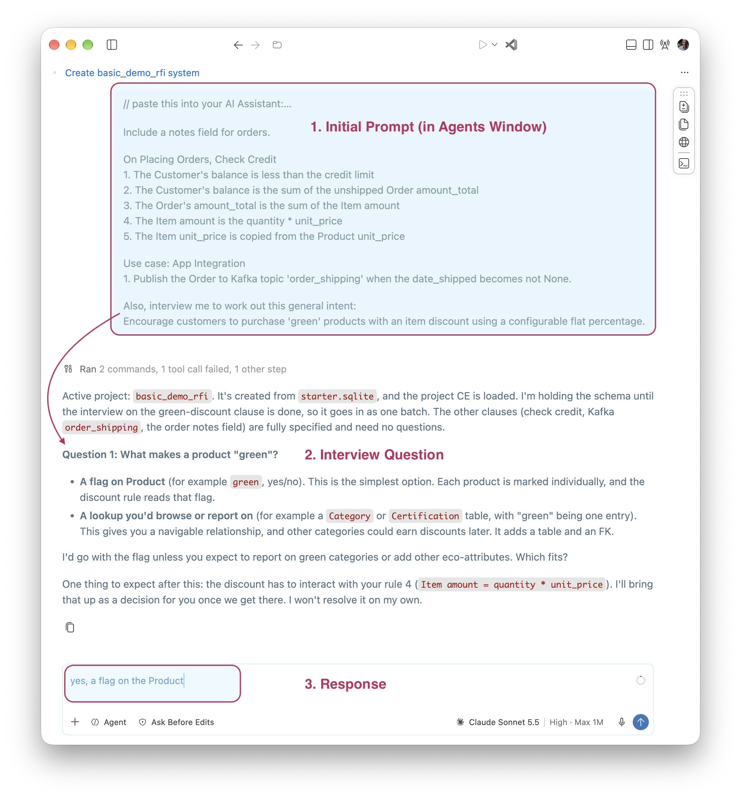
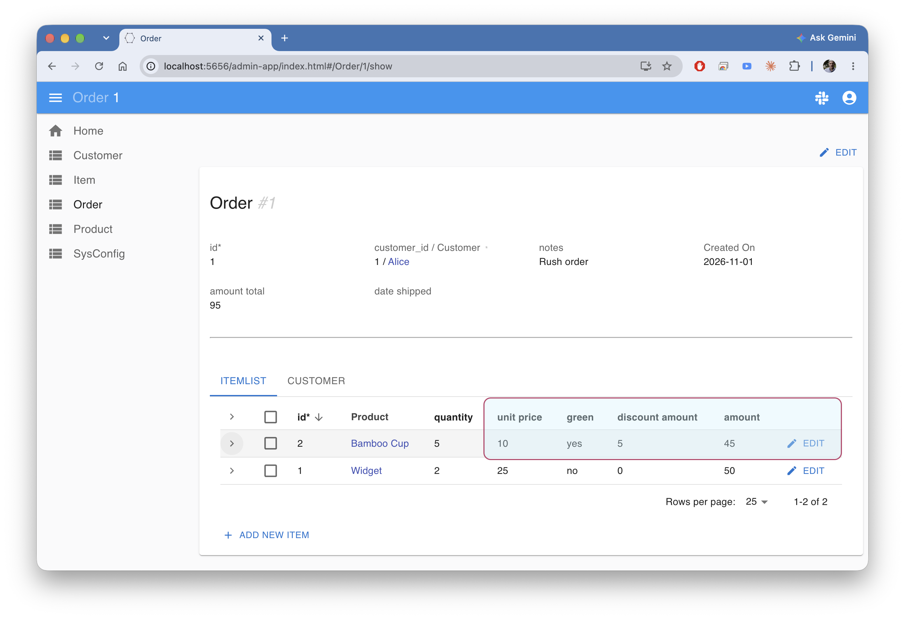

!!! pied-piper ":robot: GenAI-Logic - Architecture Brief"

    AI is remarkable at generating code, but you're left without clarity on what to govern:
    
    * the requirements are incomplete, and AI fills the gaps with guesses you never see.  How can you govern what you can't see?
    * the generated code **is hard to read and trust**.  How can you govern what you can't read?

    Our core focus is to leverage AI intent capture, extended to provide ***governance:***
    
    > Context Engineering (CE) to create enterprise-class systems based on **rules** you can **read, trust and maintain**.

    See the full background: [What Did AI Build?](Tech-RTP.md){:target="_blank" rel="noopener"}

 

{: style="width:450px"; align=right }

**Two funnels, meeting at the rules:** 

1. Virtually any form of intent becomes rules ([Executable Requirements](#executable-requirements)),
2. Every transaction source ([Enterprise-class Architecture](#enterprise-class-architecture)) is governed by them,
3. Rules run at the commit funnel - automatically ordered, reused rules over all paths ([Business Logic](#business-logic-rules-not-code)),
4. The same rules drive the governance reports ([Governance](#governance)).

More in [Governance by Architecture](Tech-Gov-By-Arch.md#two-funnels-meeting-at-the-rules){:target="_blank" rel="noopener"}.

 

---

## Business Logic - rules not code

We provide extensive CE to direct AI to generate **rules, not code**.  Rules are spreadsheet-like expressions you can:

* **Read:** [40X more concise](https://github.com/ApiLogicServer/basic_demo/blob/main/logic/procedural/declarative-vs-procedural-comparison.md){:target="_blank" rel="noopener"}, and free from dependency management complexity
* **Trust:** rules are **not called**; they are wired into the SQLAlchemy session hook, so they run on **all transaction sources** (APIs, MCP, messages, app code) and paths - **no bypass**.  Reading a rule thus tells you it runs, without tracing call paths.  **Governance by architecture**, not dependent on discipline.
* **Maintain:** change the rule, and the engine takes care of the rest: calling it, ordering it, and propagating its dependencies.

**Iterate requirements, not code:** code generation - whether AI or classic - breaks down when you have to "edit the generated code": you're patching an artifact, not the thing you actually meant.  Here, alter the requirement and get back rules that cover every path - insert, update, delete, reassignment - not just the one you designed.

See - Declare Rules with AI 

 You can declare rules in an existing project as shown below.  You can also declare them when creating projects - see [Executable Requirements](#executable-requirements).

 

**Think of a DBMS:** the rules are the DDL, and the rules engine is the database server - it runs inside your service and enforces them at commit.

**The engine is [not RETE](FAQ-RETE.md){:target="_blank" rel="noopener"}:** it is purpose-built for transactions.  It receives the actual change events, fires only the rules they affect, and [maintains aggregates incrementally](Logic-Operation.md){:target="_blank" rel="noopener"} instead of recomputing them.

**When a rule can't express it, [Python events](Logic-Type-Events.md){:target="_blank" rel="noopener"} are the extension point** - they run in the same transaction, integrated with the rules.  Events can't silently reopen the bypass: the engine [refuses to start](Logic-Type-Events.md#events-must-not-mutate-row){:target="_blank" rel="noopener"} if an event mutates a row without an explicit override.

Rules address both business logic and **Role Based Access Control.**

**The approach is [proven](Tech-Proven.md){:target="_blank" rel="noopener"}:** the same technology ran in production for decades at Wang PACE and [Versata](FAQ-Versata.md){:target="_blank" rel="noopener"}.

 

---

## Executable Requirements

**No matter how requirements are provided, [rules are created](Exec-Reqmts.md){:target="_blank" rel="noopener"}.**  CE even enables AI to [interview users](Exec-Reqmts.md#requirements-from-interview){:target="_blank" rel="noopener"} to capture requirements, or process requirements extracted from **legacy code** ([modernization](Modernization-Overview.md){:target="_blank" rel="noopener"}).

**The output is rules even when the input reads procedurally:** [given the same procedural spec](Tech-Standard-Reqs.md){:target="_blank" rel="noopener"}, native AI built the insert path only, while this pipeline produced 5 rules covering every path.  [Repeated across projects](Tech-XGR.md){:target="_blank" rel="noopener"}, the result has been **rules every time**.

This works particularly well with VSCode Agent Window, so **Developers and Business Users can share the same tools**.

See - Executable Requirements

 Developers can use AI in their standard IDE:

Business Users can use the simplified Agents Window (below).  This creates a system in minutes, including test data and screens.

> Use this to explore new business initiatives, vet the backlog... in hours.
> 

Here is the created, logic-enabled system:

 

---

## Enterprise-class architecture

Other CE elements automate systems with **rule-enabled access:**

* **[Enterprise-class APIs](API.md){:target="_blank" rel="noopener"}:** pagination, [optimistic locking](API-Opt-Lock.md){:target="_blank" rel="noopener"}, filtering, sorting etc.  APIs are **automatically [MCP enabled](Integration-MCP.md){:target="_blank" rel="noopener"}**, so agents can invoke them with full deterministic logic enforcement.
* **[Message handling](Integration-EAI.md){:target="_blank" rel="noopener"}:** subscribe and publish

**Proof points:** [Customs CLVS](Customs-clvs-readme.md){:target="_blank" rel="noopener"}, [Surtax](Customs-readme-surtax.md){:target="_blank" rel="noopener"}, [Budget Allocation](Sample_Allo_Dept_GL_readme.md){:target="_blank" rel="noopener"}

 

---

## Governance

In addition to no-bypass transaction logic **runtime enforcement**, the system provides **review support** with:

* **[Test creation and execution](Behave.md){:target="_blank" rel="noopener"}**, by leveraging rules, to verify the requirements and rule execution
* **[Traceability reports](Behave-Logic-Report.md){:target="_blank" rel="noopener"}** that trace requirements to the underlying rules, and confirm their execution on tests
* **AI Alerts:** reports where AI proactively calls for review for inferences drawn from incomplete or vague requirements - and where there is no safe default, it **stops and leaves a `FIXME`** rather than guessing
* **Logic flow diagrams and a health check** (rule adoption, dependency-tracking integrity), generated from the rules
* **[Ontology creation](Database-Ontology.md){:target="_blank" rel="noopener"}** (including type support) makes systems available to an important class of tools, and provides terminology clarity for business users

[More on project governance](Manager-readme.md#rules-you-can-read){:target="_blank" rel="noopener"}.

 

---

## Works with your other tools

Your IDE, your debugger, your git, all work normally. Rules are plain Python files, full logging and debugging, and committed like everything else.

Stack: Python, Flask, SQLAlchemy, Docker. Works with MySQL, Postgres, SQL Server, Oracle, SQLite. Nothing proprietary, nothing to unlearn.

Standard JSON:APIs enable the use of [**Vibe tools**](Admin-Vibe.md){:target="_blank" rel="noopener"} for custom UI dev.

 
