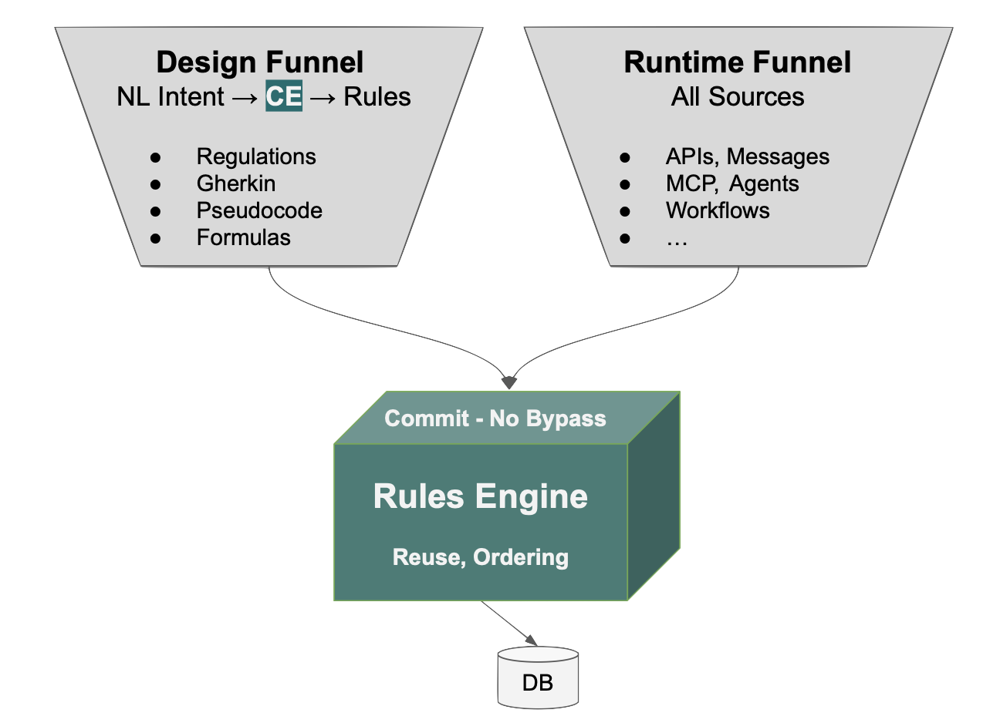

# GenAI-Logic for Architects

AI is remarkable at generating code, but [it's hard to read and trust](Manager-readme.md#ai-alone){:target="_blank" rel="noopener"}.  Our core focus is to leverage AI intent capture, but direct it to create enterprise-class systems you can read, trust and maintain.

Two funnels, meeting at the rules: any form of intent becomes rules (section 3), and every transaction source is governed by them (sections 1 and 2).  More in [Governance by Architecture](Tech-Gov-By-Arch.md#two-funnels-meeting-at-the-rules){:target="_blank" rel="noopener"}.

## 1. Business Logic - rules not code

We provide extensive CE to direct AI to generate rules not code:

* read: [40X more concise](https://github.com/ApiLogicServer/basic_demo/blob/main/logic/procedural/declarative-vs-procedural-comparison.md){:target="_blank" rel="noopener"}, and free from dependency management complexity
* trust: rules are not called; they are wired into a single SQLAlchemy `before_flush` listener, so they run on all transaction sources (APIs, MCP, messages, app code) and paths - no second door.  Reading a rule tells you it runs, without tracing call sites.  Governance by architecture, not discipline.
* maintain: change a requirement, change one rule.  The engine re-derives everything that depends on it - no hunting for change paths, and no regenerating and re-reviewing procedural code.

Think of a DBMS: the rules are the DDL, and the rules engine is the database server - it runs inside your service and enforces them at commit.

The engine is [not RETE](FAQ-RETE.md){:target="_blank" rel="noopener"}: it is purpose-built for transactions.  It receives the actual change events, fires only the rules they affect, and [maintains aggregates incrementally](Logic-Operation.md){:target="_blank" rel="noopener"} instead of recomputing them.

When a rule can't express it, [Python events](Logic-Type-Events.md){:target="_blank" rel="noopener"} are the extension point - they run in the same transaction, integrated with the rules.  Events can't silently reopen the bypass: the engine [refuses to start](Logic-Type-Events.md#events-must-not-mutate-row){:target="_blank" rel="noopener"} if an event mutates a row without an explicit override.

The approach is [proven](Tech-Proven.md){:target="_blank" rel="noopener"}: the same technology ran in production for decades at Wang PACE and [Versata](FAQ-Versata.md){:target="_blank" rel="noopener"}.

 

## 2. Enterprise-class architecture

That same CE automates systems with rule-enabled access:

* [enterprise-class APIs](API.md){:target="_blank" rel="noopener"}: pagination, [optimistic locking](API-Opt-Lock.md){:target="_blank" rel="noopener"}, filtering, sorting etc.  APIs are automatically [MCP enabled](Integration-MCP.md){:target="_blank" rel="noopener"}, so agents can invoke them with full deterministic logic enforcement.
* [message handling](Integration-EAI.md){:target="_blank" rel="noopener"}: declare subscribe and publish

 

## 3. Executable Requirements

CE ensures that no matter how requirements are provided, [rules are created](Exec-Reqmts.md){:target="_blank" rel="noopener"}.  CE even enables AI to [*interview* users](Exec-Reqmts.md#requirements-from-interview){:target="_blank" rel="noopener"} to capture requirements, or process requirements extracted from legacy code ([Modernization](Modernization-Overview.md){:target="_blank" rel="noopener"}).

The output is rules even when the input reads procedurally: [given the same procedural spec](Tech-Standard-Reqs.md){:target="_blank" rel="noopener"}, native AI built the insert path only, while this pipeline produced 5 rules covering every path.  [Repeated across projects](Tech-XGR.md){:target="_blank" rel="noopener"}, the result has been rules every time.

This works particularly well with VSCode Agent Window, so Developers and Business Users can share the same tools.  

 

## 4. Governance

In addition to no-bypass transaction logic *runtime* enforcement, the system provides reports *review* support with:

* [test creation and execution](Behave.md){:target="_blank" rel="noopener"}, by leveraging rules
* [reports](Behave-Logic-Report.md){:target="_blank" rel="noopener"} that trace requirements to the underlying rules, and confirming their execution on tests
* reports where AI proactively calls for review for inferences drawn from incomplete or vague requirements - and where there is no safe default, it stops and leaves a `FIXME` rather than guessing
* logic flow diagrams and a health check (rule adoption, dependency-tracking integrity), generated from the rules

[More on project governance](Manager-readme.md#rules-you-can-read){:target="_blank" rel="noopener"}.

 

## 5. Works with your other tools

GenAI-Logic uses standard databases and IDEs.  Standard JSON:APIs enable the use of [Vibe tools](Admin-Vibe.md){:target="_blank" rel="noopener"} for custom UI dev.
