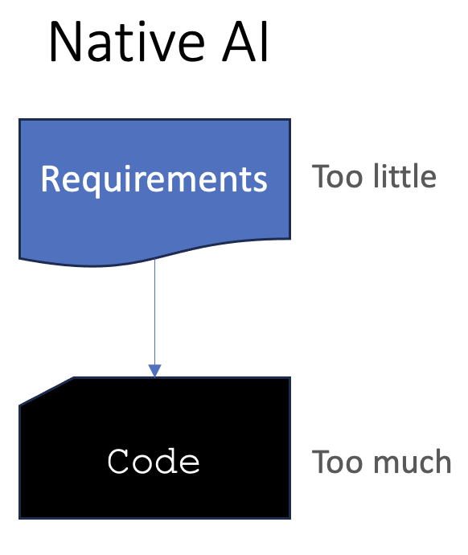
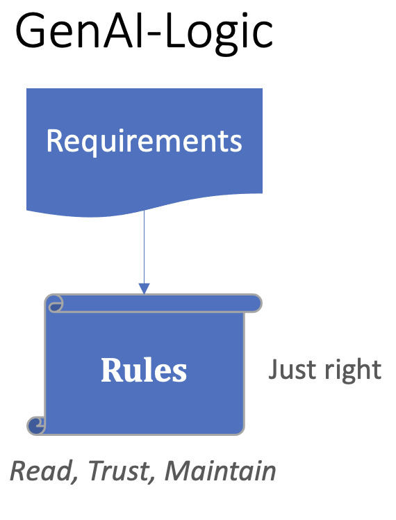
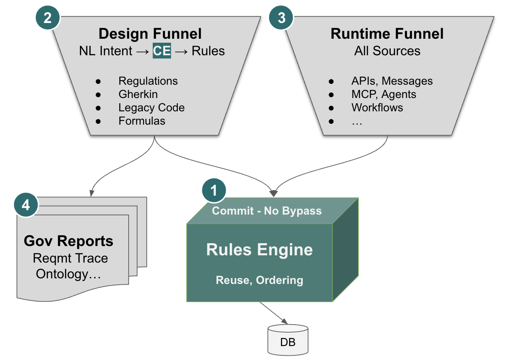
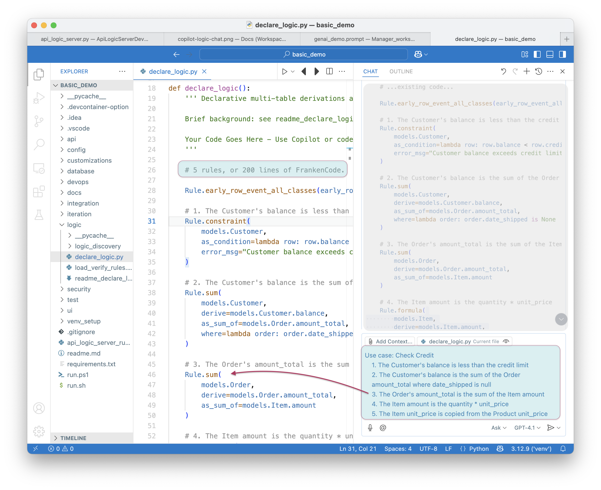
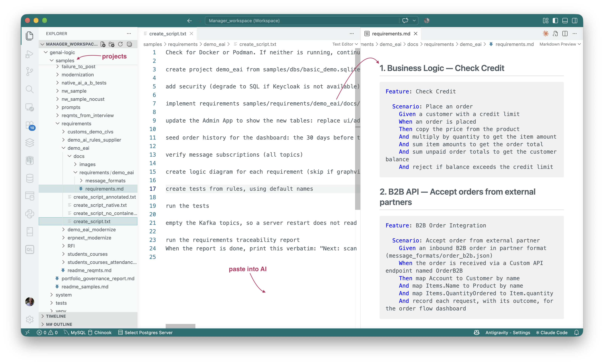
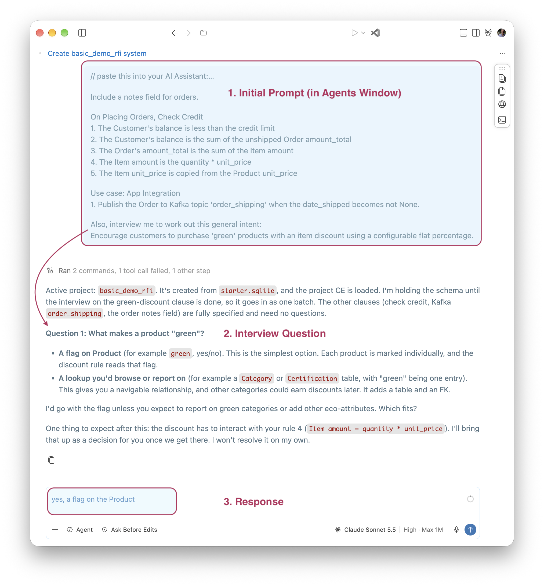
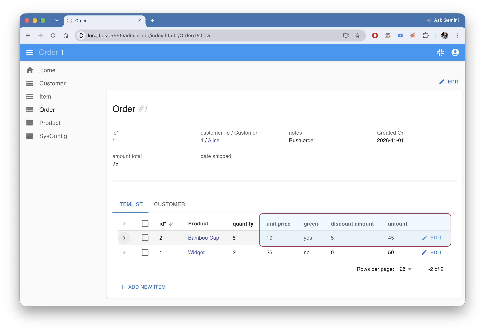
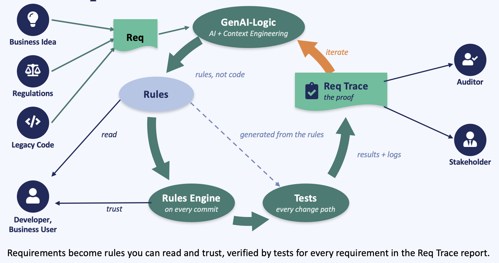

!!! pied-piper ":robot: GenAI-Logic - Architecture Brief"

    {: style="width:165px"; align=right }

    AI is remarkable at generating code, but **hard to govern:**
    
    * the *requirements* are incomplete, and AI fills the gaps with **guesses you never see.**  How can you govern what you can't see?
    * the *generated code* is **hard to read and trust**.  How can you govern what you can't read?
    * and you still need to prove it does what you asked - **testing is the new bottleneck**.  How can you govern what you can't prove?

     **The answer:** Context Engineering (CE) directs AI to **translate requirements into rules, not code**. So you can adopt AI **prudently**:

    {: style="width:165px; clear:right" align=right }

    * **See the guesses** - AI flags every assumption it made for review, and leaves a `FIXME` where there is no safe default. 
    * **Read and trust the rules** - 40x more concise than code, and enforced by the rules engine at commit, on every transaction from every source - no bypass. 
    * **Prove the rules ran, and check what they mean** - generated tests run, and the traceability report shows each requirement, its rules, and the logs of them firing, so a reviewer can confirm each rule says what its requirement means.
    

    For a related article, [Click Here - What Did AI Build?](Tech-RTP.md){:target="_blank" rel="noopener"}

    **See every claim in one system:** the [EAI sample](Sample-Basic-EAI.md){:target="_blank" rel="noopener"} was built by AI from six requirements: rules, a B2B API, Kafka in and out, security, and a dashboard showing the business is flowing.  Its judgment calls, rules and traceability report are the evidence for each claim above.

    **Try it in 10 minutes:** [First Time Here](Manager-readme.md#first-time-here){:target="_blank" rel="noopener"} - paste one prompt, run the system, and watch a rule reject a bad save.

 

{: style="width:450px"; align=right }

**Two funnels, meeting at the rules:** 

1. Virtually any form of intent becomes rules ([Executable Requirements](#executable-requirements)),
2. Every transaction source ([Enterprise-class Architecture](#enterprise-class-architecture)) is governed by them,
3. Rules run at the commit funnel - automatically ordered, reused over all paths ([Business Logic](#business-logic-rules-not-code)),
4. The same rules drive the governance reports ([Governance](#governance-proof-not-just-review)).

More in [Governance by Architecture](Tech-Gov-By-Arch.md#two-funnels-meeting-at-the-rules){:target="_blank" rel="noopener"}.

 

---

## Business Logic - rules not code

We provide extensive CE to direct AI to generate **rules, not code**.  Rules are spreadsheet-like expressions you can:

* **Read:** 5 rules vs ~220 lines of procedural code for the same requirements ([40X more concise](https://github.com/ApiLogicServer/basic_demo/blob/main/logic/procedural/declarative-vs-procedural-comparison.md){:target="_blank" rel="noopener"}; same AI, same behavior), and free from dependency management complexity
* **Trust:** rules are ***automatically* called** by the SQLAlchemy session hook, so they run on **all transaction sources** (APIs, MCP, messages, app code) - **no bypass**.[^1]  Reading a rule thus tells you it runs, without tracing call paths.  **Commit-level invariants, not call-site discipline:** no helper to remember in every handler - governance by architecture.
* **Maintain:** change the rule, and the engine takes care of the rest: calling it, ordering it, and propagating its dependencies.

**Iterate requirements, not code:** code generation - whether AI or classic - breaks down when you have to "edit the generated code": you're patching an artifact, not the thing you actually meant.  Here, alter the requirement and get back rules that cover every path - insert, update, delete, reassignment - not just the one you designed.  For more information, [click here](Exec-Reqmts.md#requirements-iteration){:target="_blank" rel="noopener"}.

See - Declare Rules with AI 

 You can declare rules in an existing project as shown below.  You can also declare them when creating projects - see [Executable Requirements](#executable-requirements).

The Context Engineering is a (large) set of files under `docs`.

 

AI creates rules at design time - runtime execution is **deterministic**.  Their readability facilitates *"human in the loop"* review (see the example above) to verify proper AI rule creation.  More on [how AI is used: authoring, not runtime](Project-AI-Enabled.md#how-ai-is-used-authoring-not-runtime){:target="_blank" rel="noopener"} (including context vs. prompt engineering, and why not RAG).

**Better models don't remove the need:** even if AI becomes good enough that the prompt is the system of record, and code is compiler output nobody reads, governance still needs something you can read and check.  Rules are that artifact, whichever model wrote them.

**Probabilistic rules are an *"opt-in"*** (e.g. choose the [optimal supplier](Sample-ai-rules.md){:target="_blank" rel="noopener"}, subject to world conditions).  These rules operate at runtime.  The values are always subjected to the deterministic constraints.

**Think of a DBMS:** the rules are the DDL, and the rules engine is the database server - it runs inside your service and enforces them at commit.

**The rules engine is [not RETE](FAQ-RETE.md){:target="_blank" rel="noopener"}:** it is purpose-built for transactions.  It receives the actual change events, fires only the rules they affect, and [maintains aggregates incrementally](Logic-Operation.md){:target="_blank" rel="noopener"} instead of recomputing them.

**When a rule can't express it, [Python events](Logic-Type-Events.md){:target="_blank" rel="noopener"} are the extension point** - they run in the same transaction, integrated with the rules.  Events can't silently reopen the bypass: the engine [refuses to start](Logic-Type-Events.md#events-must-not-mutate-row){:target="_blank" rel="noopener"} if an event mutates a row without an explicit override.

While you can enter rules using IDE code completion, most use AI to specify requirements as shown above.  Since requirements can be specified in virtually any format, this makes the system **highly adoptable** - your team simply provides requirements in the formats to which they are accustomed.  You no longer need to *think* in rules to author them, only to *read* them.

Rules address both transaction logic and **Role Based Access Control.**

**The approach is [proven](Tech-Proven.md){:target="_blank" rel="noopener"}:** the same technology ran in production for decades at Wang PACE and [Versata](FAQ-Versata.md){:target="_blank" rel="noopener"}.

 

---

## Executable Requirements

**No matter how requirements are provided, [rules are created](Exec-Reqmts.md){:target="_blank" rel="noopener"}.**  CE even enables AI to [interview users](Exec-Reqmts.md#requirements-from-interview){:target="_blank" rel="noopener"} to capture requirements, or process requirements extracted from **legacy code** ([modernization](Modernization-Overview.md){:target="_blank" rel="noopener"}).

**The output is rules even when the input reads procedurally:** [given the same procedural spec](Tech-Standard-Reqs.md){:target="_blank" rel="noopener"}, native AI built the insert path only, while this pipeline produced 5 rules covering every path.  [Repeated across projects](Tech-XGR.md){:target="_blank" rel="noopener"}, the result has been **rules every time**.

This works particularly well with VSCode Agent Window, so **Developers and Business Users can share the same tools**.

### New Initiatives and Modernization

**New initiatives:** requirements come from a business idea, a backlog item, or an AI interview with the user.  Since the created system includes **test data and a UI**, business users can vet the backlog with **real logic running on real transactions**, not wireframes.

**Modernization:** AI [extracts requirements from the legacy system](Modernization-Overview.md){:target="_blank" rel="noopener"}, and those requirements are fed to GenAI-Logic to create **rules** - modernizing the *logic*, rather than a platform port of the old code.

See - Executable Requirements

 Developers can use AI in their standard IDE:

Business Users can use the simplified Agents Window (below).  This creates a system in minutes, including test data and screens.

Here is the created, logic-enabled system.  Business Users can **enter real transactions**, see business logic execute, and **collaborate on iterations.**

 

---

## Enterprise-class architecture

Other CE elements automate systems with **rule-enabled access:**

* **[Enterprise-class APIs](API.md){:target="_blank" rel="noopener"}:** pagination, [optimistic locking](API-Opt-Lock.md){:target="_blank" rel="noopener"}, filtering, sorting etc.  APIs are **automatically [MCP enabled](Integration-MCP.md){:target="_blank" rel="noopener"}**, so agents can invoke them with full deterministic logic enforcement.
* **[Message handling](Integration-EAI.md){:target="_blank" rel="noopener"}:** subscribe and publish

**Proof points:** 

* [EAI sample](Sample-Basic-EAI.md){:target="_blank" rel="noopener"} - the integration patterns above (B2B API, Kafka subscribe and publish, security), from requirements, tested and traced
* [Customs CLVS](Customs-clvs-readme.md){:target="_blank" rel="noopener"} - rule-based system closes a $20m/yr audit exposure
* [Customs Surtax](Customs-readme-surtax.md){:target="_blank" rel="noopener"} - "reg tech" system automated from web-based regulations
* [Budget Allocation](Sample_Allo_Dept_GL_readme.md){:target="_blank" rel="noopener"} - complex logic, delivered in 2 days, vs. 2 year failed effort

 

---

## Governance - proof, not just review

Reading the rules isn't enough, and AI output doesn't verify itself.  Before anyone can approve deployment, they need evidence that the system does what it set out to do.

That evidence is generated, **closing the loop** to show each requirement is tested, with verified rule execution:

1. **[Tests are generated from the rules](Behave.md){:target="_blank" rel="noopener"}**[^2], one Feature per requirement, covering each change path every rule implies (for a sum: insert, update, delete, and moving a row to a different parent; for a constraint: accepted, at the boundary, and rejected).
2. **The tests run**, and the rules engine logs every rule that fires.
3. **The [Requirements Traceability Report](https://github.com/ApiLogicServer/ApiLogicServer-src/blob/main/api_logic_server_cli/prototypes/manager/samples/basic_demo_eai/docs/requirements/Requirements%20Traceability%20Report.md){:target="_blank" rel="noopener"}** (from the EAI sample) is built from that run: for each requirement, the rules that implement it, the tests that exercise it, and the logs of those rules firing - side by side with the requirement text, so a reviewer can confirm each rule says what its requirement means.

**The result: an executed record you can hand an auditor** - each rule beside the requirement it implements, with evidence that it ran.  The record shows the rules ran and passed; people confirm each rule *means* what its requirement says (see the second point below, and note 2).  The report also states what it does *not* cover, so a gap is visible rather than silent.

Two things keep the record trustworthy:

* **The guesses are visible.**  The record is only as good as the interpretation behind it.  [AI Alerts](https://github.com/ApiLogicServer/ApiLogicServer-src/blob/main/api_logic_server_cli/prototypes/manager/samples/basic_demo_eai/docs/requirements/demo_eai/ad-libs.md){:target="_blank" rel="noopener"} (from the EAI sample) flag every inference drawn from vague requirements, and where there is no safe default, the AI **stops and leaves a `FIXME`** instead of a test that would pass for the wrong reason.
* **The rules can't be bypassed.**  The rules the tests exercised are the same rules that run at commit on every transaction in production[^1] - not a separate code path that might differ.

Also generated from the rules: **logic flow diagrams**, a **health check** (rule adoption, dependency-tracking integrity), and an **[ontology](https://apilogicserver.github.io/Docs/Database-Ontology/){:target="_blank" rel="noopener"}** (including type support) for tools and business terminology.

[More on project governance](Manager-readme.md#rules-you-can-read){:target="_blank" rel="noopener"}.

 

---

## Works with your other tools

Your IDE, your debugger, your git, all work normally. Rules are plain Python files, full logging and debugging, and committed like everything else.

Deploys as a standard container.

Stack: Python, Flask, SQLAlchemy, Docker. Works with MySQL, Postgres, SQL Server, Oracle, SQLite. Nothing proprietary, nothing to unlearn.[^1]

Standard JSON:APIs enable the use of [**Vibe tools**](Admin-Vibe.md){:target="_blank" rel="noopener"} for custom UI dev.

 

[^1]: **Boundaries** - where the guarantees stop, and where the approach does not fit:

    * **Writes around the logic tier:** every write through the logic tier (the application's data layer, where the rules are hooked in) is governed.  As in any 3-tier system, direct database access around that tier is outside this guarantee.  [More on no-bypass](FAQ-Rules-Learning.md#trust-on-commit-no-bypass){:target="_blank" rel="noopener"}.
    * **Workloads:** rules govern transactional data - derivations, constraints and actions on commit.  They are not for analytics / OLAP, or for systems whose behavior is mostly not data transactions.  You may find it useful to employ [complementary technologies](FAQ-RETE.md#key-differences-in-rules-engines-process-decision-transaction){:target="_blank" rel="noopener"} for process and decision logic.
    * **Lock-in:** the stack is standard, and the rules engine (LogicBank) is open source.  But rules are written against its API; leaving means re-expressing them as procedural code - the code they replaced.  [Standards, not a proprietary studio](FAQ-Low-Code.md#devs-standards-architecture){:target="_blank" rel="noopener"}.

[^2]: **Independent tests:** the rules suggest *what* to test - each change path they imply.  The tests then run through the API like any client, and check the resulting data against fixed expected values; they never ask the engine for the answer.  Whether each rule means what its requirement says is confirmed by people, reading the trace.
