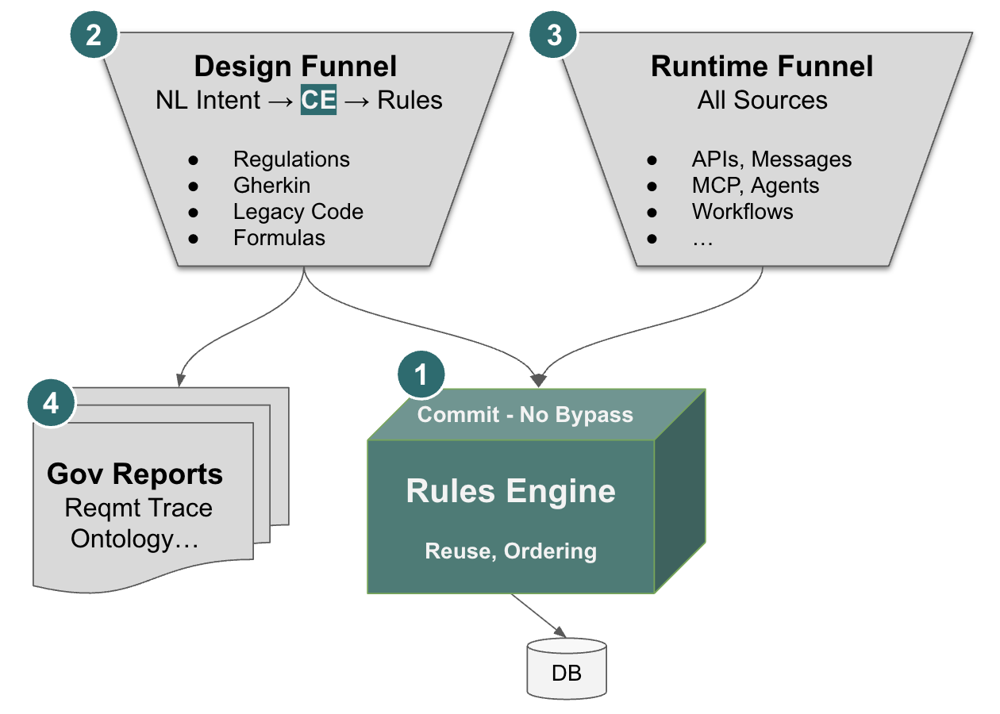
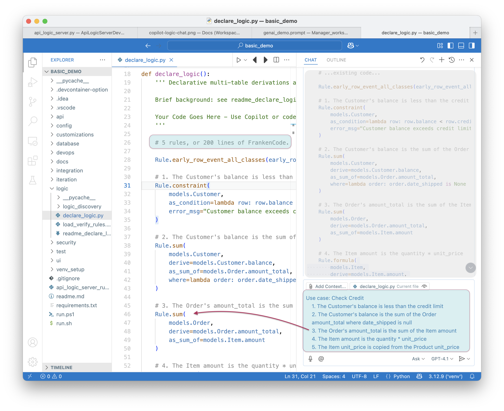
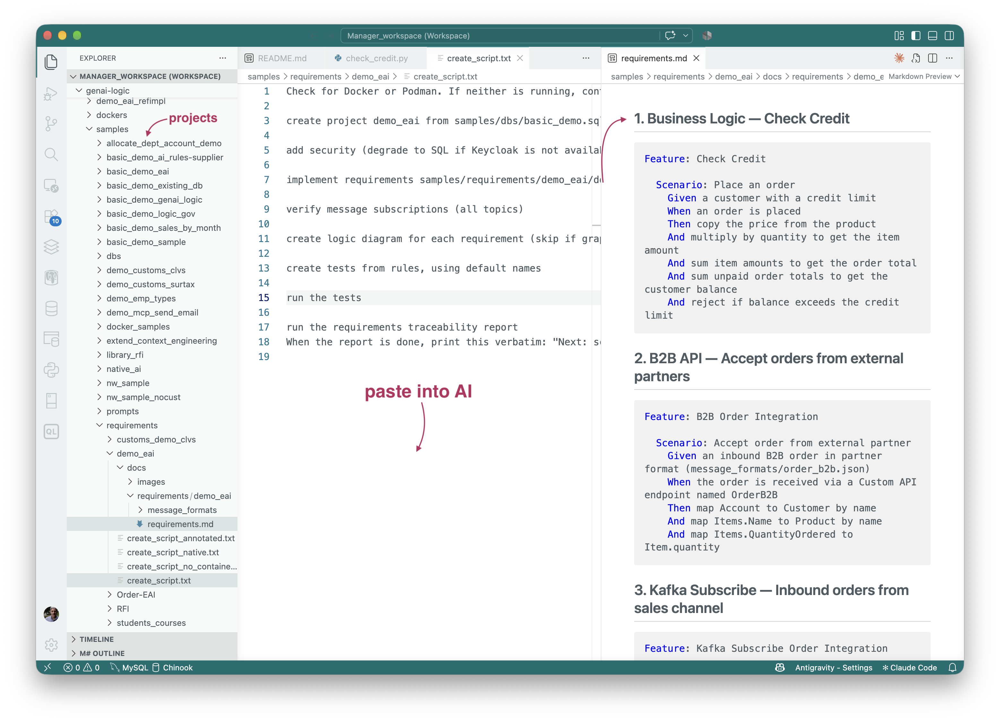

!!! pied-piper ":robot: Welcome to GenAI-Logic"
    AI is remarkable at generating code, but [it's **hard to read and trust**](Manager-readme.md#ai-alone){:target="_blank" rel="noopener"}.  How can you govern what you can't read?
    
    Our core focus is to leverage AI intent capture, but direct it to create enterprise-class systems you can **read, trust and maintain**.

 

**Two funnels, meeting at the rules:** any form of intent becomes rules (2), every transaction source (3) is governed by them at commit (1), and the same rules drive the governance reports (4).  More in [Governance by Architecture](Tech-Gov-By-Arch.md#two-funnels-meeting-at-the-rules){:target="_blank" rel="noopener"}.

## 1. Business Logic - rules not code

We provide extensive CE to direct AI to generate **rules, not code:**

* **Read:** [40X more concise](https://github.com/ApiLogicServer/basic_demo/blob/main/logic/procedural/declarative-vs-procedural-comparison.md){:target="_blank" rel="noopener"}, and free from dependency management complexity
* **Trust:** rules are **not called**; they are wired into a single SQLAlchemy `before_flush` listener, so they run on **all transaction sources** (APIs, MCP, messages, app code) and paths - **no second door**.  Reading a rule tells you it runs, without tracing call sites.  **Governance by architecture, not discipline.**
* **Maintain:** change a requirement, **change one rule**.  The engine re-derives everything that depends on it - no hunting for change paths, and no regenerating and re-reviewing procedural code.

**Iterate requirements, not code:** code generation - whether AI or classic - breaks down when you have to "edit the generated code": you're patching an artifact, not the thing you actually meant.  Here, you describe the next requirement and get back a rule that covers every path - insert, update, delete, reassignment - not just the one you tested.  When you do need code, it lives alongside the rules, not layered on top of them.

See - Declare Rules with AI 

 You can declare rules in an existing project as shown below.  You can also declare them when creating projects - see **2. Executable Requirements**.

 

**Think of a DBMS:** the rules are the DDL, and the rules engine is the database server - it runs inside your service and enforces them at commit.

**The engine is [not RETE](FAQ-RETE.md){:target="_blank" rel="noopener"}:** it is purpose-built for transactions.  It receives the actual change events, fires only the rules they affect, and [maintains aggregates incrementally](Logic-Operation.md){:target="_blank" rel="noopener"} instead of recomputing them.

**When a rule can't express it, [Python events](Logic-Type-Events.md){:target="_blank" rel="noopener"} are the extension point** - they run in the same transaction, integrated with the rules.  Events can't silently reopen the bypass: the engine [refuses to start](Logic-Type-Events.md#events-must-not-mutate-row){:target="_blank" rel="noopener"} if an event mutates a row without an explicit override.

**Rules address business logic and Role Based Access Control.**

**The approach is [proven](Tech-Proven.md){:target="_blank" rel="noopener"}:** the same technology ran in production for decades at Wang PACE and [Versata](FAQ-Versata.md){:target="_blank" rel="noopener"}.

 

## 2. Executable Requirements

**No matter how requirements are provided, [rules are created](Exec-Reqmts.md){:target="_blank" rel="noopener"}.**  CE even enables AI to [**interview** users](Exec-Reqmts.md#requirements-from-interview){:target="_blank" rel="noopener"} to capture requirements, or process requirements extracted from **legacy code** ([Modernization](Modernization-Overview.md){:target="_blank" rel="noopener"}).

**The output is rules even when the input reads procedurally:** [given the same procedural spec](Tech-Standard-Reqs.md){:target="_blank" rel="noopener"}, native AI built the insert path only, while this pipeline produced 5 rules covering every path.  [Repeated across projects](Tech-XGR.md){:target="_blank" rel="noopener"}, the result has been **rules every time**.

This works particularly well with VSCode Agent Window, so **Developers and Business Users can share the same tools**.

See - Requirements Specification

 

 

## 3. Enterprise-class architecture

That same CE automates systems with **rule-enabled access:**

* **[Enterprise-class APIs](API.md){:target="_blank" rel="noopener"}:** pagination, [optimistic locking](API-Opt-Lock.md){:target="_blank" rel="noopener"}, filtering, sorting etc.  APIs are automatically [**MCP enabled**](Integration-MCP.md){:target="_blank" rel="noopener"}, so agents can invoke them with full deterministic logic enforcement.
* **[Message handling](Integration-EAI.md){:target="_blank" rel="noopener"}:** declare subscribe and publish

**Proof points:** [Customs CLVS](Customs-clvs-readme.md){:target="_blank" rel="noopener"}, [Surtax](Customs-readme-surtax.md){:target="_blank" rel="noopener"}, [Budget Allocation](Sample_Allo_Dept_GL_readme.md){:target="_blank" rel="noopener"}

 

## 4. Governance

In addition to no-bypass transaction logic **runtime enforcement**, the system provides **review support** with:

* **[Test creation and execution](Behave.md){:target="_blank" rel="noopener"}**, by leveraging rules, to verify the requirements and rule execution
* **[Traceability reports](Behave-Logic-Report.md){:target="_blank" rel="noopener"}** that trace requirements to the underlying rules, and confirm their execution on tests
* **AI Alerts:** reports where AI proactively calls for review for inferences drawn from incomplete or vague requirements - and where there is no safe default, it **stops and leaves a `FIXME`** rather than guessing
* **Logic flow diagrams and a health check** (rule adoption, dependency-tracking integrity), generated from the rules
* **[Ontology creation](Database-Ontology.md){:target="_blank" rel="noopener"}** makes systems available to an important class of tools, and provides terminology clarity for business users

[More on project governance](Manager-readme.md#rules-you-can-read){:target="_blank" rel="noopener"}.

 

## 5. Works with your other tools

Your IDE, your debugger, your git, all work normally. Rules are plain Python files, committed like everything else. Stack: Python, Flask, SQLAlchemy, Docker. Works with MySQL, Postgres, SQL Server, Oracle, SQLite. Nothing proprietary, nothing to unlearn.

Standard JSON:APIs enable the use of [**Vibe tools**](Admin-Vibe.md){:target="_blank" rel="noopener"} for custom UI dev.

 
