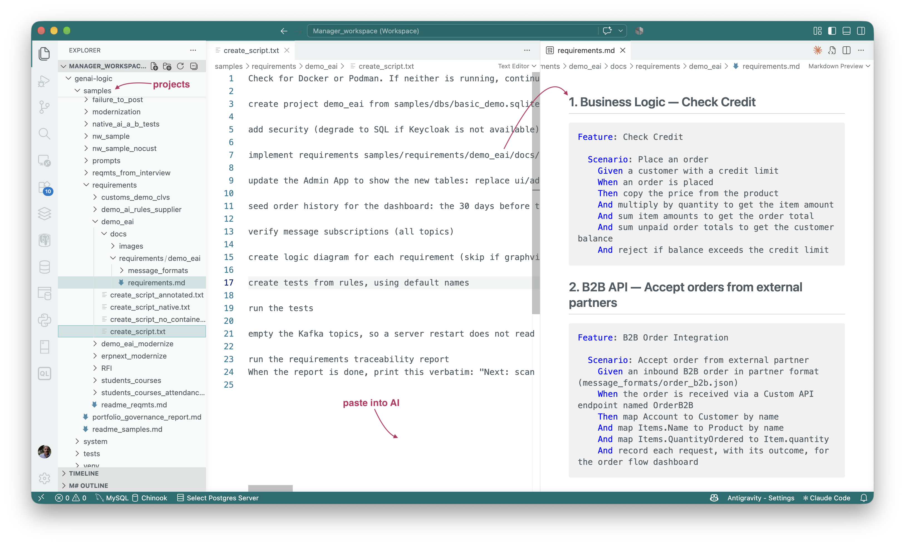
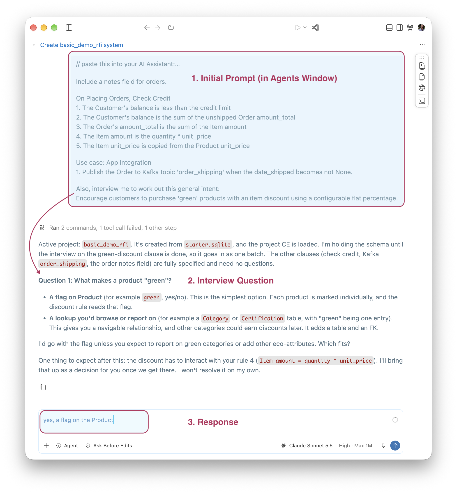
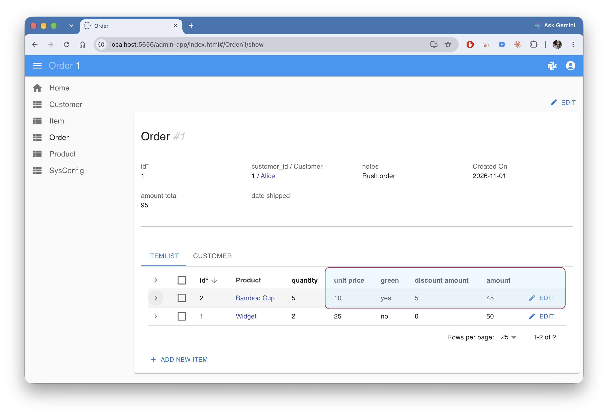
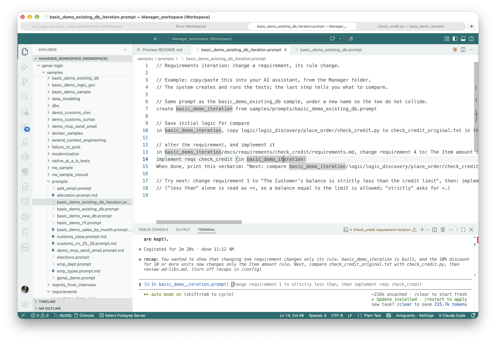
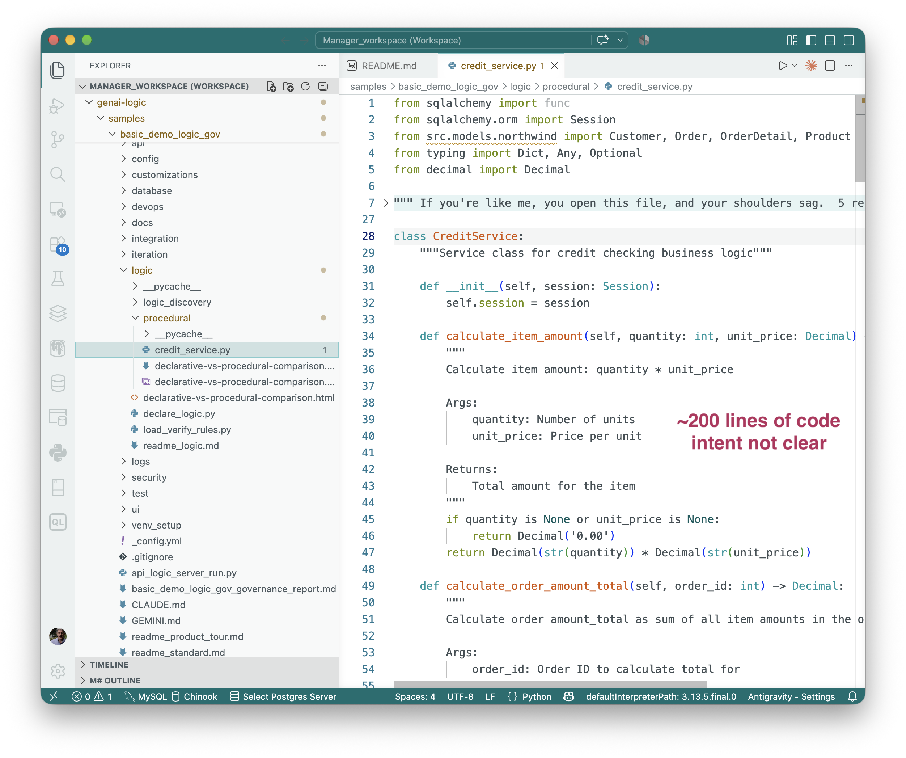
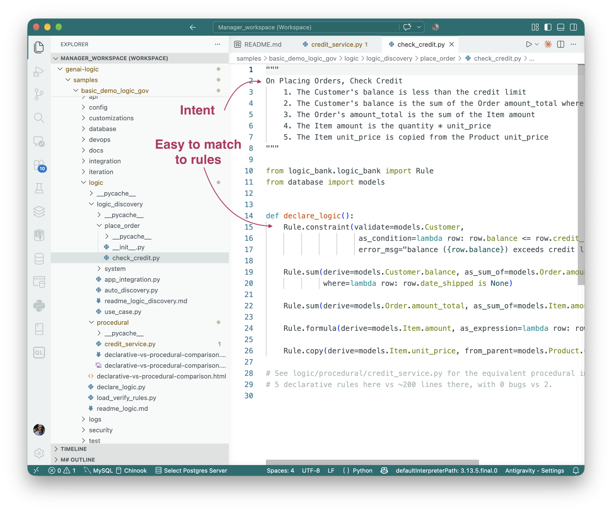
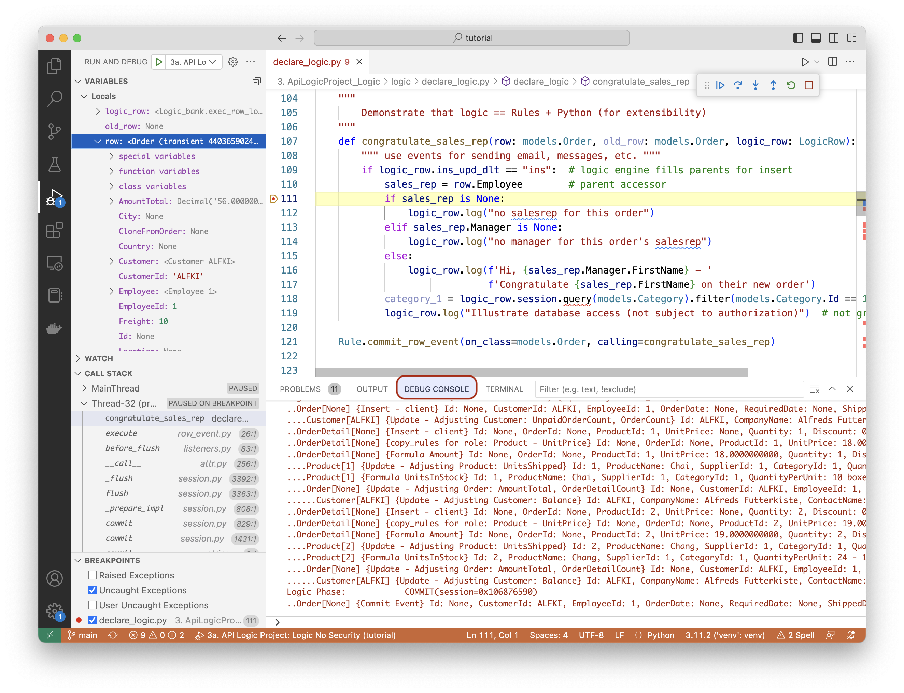

<!--
Audience: developers evaluating GenAI-Logic.
Tone: plain description - what it is, and how you use it.  No persuasion.
Structure: three design goals in the box (two classic frictions, plus a constraint); sections grouped under them; trade-offs last.
Terminology: "rules" throughout (matches the rest of the docs), introduced once as declarative Python code.
Companion to Tech-Architects.md (same claims, from the developer's seat).
-->

<style>
  .md-typeset h1,
  .md-content__button {
    display: none;
  }
</style>

!!! pied-piper ":computer: GenAI-Logic - Developer Brief"

    GenAI-Logic uses AI to create systems from requirements, and states their business logic as **rules**: declarative Python code, in your own source files.  It has three design goals:

    1. **Significantly less procedural code:** AI tends to generate a lot of it ("code bloat").  Rules address that: they declare *what* must be true, not *when and where* to compute it - 5 rules in place of ~220 lines.
    2. **Easier maintenance, without doc drift:** change the requirement, and the rules, tests and documentation follow from it.
    3. **Keep your standard tools:** Python, your IDE and debugger, git, and containers.

    **Try it in 10 minutes:** [First Time Here](Manager-readme.md#first-time-here){:target="_blank" rel="noopener"} - paste one prompt, run the system, and watch a rule reject a bad save.

<br>

---

## Getting started: the typical flow

Work happens in your IDE, with your AI assistant, from the Manager workspace (where projects are created).  Click a picture to enlarge it.

[{: style="width:260px"; align=right }](images/integration/demo_eai/create_script.png){:target="_blank" rel="noopener"}

**1. Describe the system.**  Write the requirements in the format you already use - numbered prose, Gherkin, or a procedural spec - in `requirements.md`.  Then paste a short script into your AI assistant: create the project, implement the requirements, create and run the tests.  The script shown builds the EAI sample: Check Credit logic, a B2B API, and Kafka messaging.

<br clear="all">

[{: style="width:200px"; align=right }](images/exec_reqmts/rfi_with_int_bd_rfi.png){:target="_blank" rel="noopener"}

**Or let the AI ask.**  Where a requirement is only a general intent, say so, and the AI interviews you about it - here, what makes a product "green" for a discount - while it builds the parts that are already specified.  The simpler Agents Window (shown) lets business users take part.

<br clear="all">

[{: style="width:260px"; align=right }](images/exec_reqmts/rfi_with_int_bd.png){:target="_blank" rel="noopener"}

**2. Run it.**  The project runs immediately, with test data and an admin UI.  Enter transactions and watch the rules work: here the green product's discount and amount are derived, and the Order total follows.

<br clear="all">

[{: style="width:260px"; align=right }](images/exec_reqmts/iterate-requirements.png){:target="_blank" rel="noopener"}

**3. Change it.**  Edit a requirement, then `implement reqs <name>`.  The AI changes only the rules that implement it - here a 10% discount for 10 or more units changes the Item amount rule, and nothing else.  See [Goal 2](#goal-2-easier-maintenance-without-doc-drift).

<br clear="all">

**4. Verify it.**  Create and run the tests, and generate the Requirements Traceability Report - see [Docs that don't drift](#docs-that-dont-drift).  From there, it is a standard Python project: open it in your IDE, debug, commit, and deploy as a container.

<br>

---

## Goal 1: Significantly less procedural code

### What is created

Each project starts as a running system, created from your database or your requirements:

* **[APIs](API.md){:target="_blank" rel="noopener"}:** JSON:API with pagination, filtering, sorting and [optimistic locking](API-Opt-Lock.md){:target="_blank" rel="noopener"}, [MCP enabled](Integration-MCP.md){:target="_blank" rel="noopener"}
* **An admin UI**, for testing and back-office use; the standard APIs also support [your own UI tools](Admin-Vibe.md){:target="_blank" rel="noopener"}
* **Models, security and [messaging](Integration-EAI.md){:target="_blank" rel="noopener"}** (Kafka subscribe and publish)

The architecture comes from the engines and the Context Engineering (CE), so it is the same in every project rather than chosen each time AI runs.

&nbsp;

### Business logic: rules

Rules are declarative code, like SQL or a spreadsheet formula: `Rule.sum(...)`, `Rule.formula(...)`, `Rule.constraint(...)`, with expressions such as `balance <= credit_limit`.  You, or your AI assistant, write them; the CE directs AI to write rules rather than procedural code.

* **Size:** [5 rules vs ~220 lines](https://github.com/ApiLogicServer/basic_demo/blob/main/logic/procedural/declarative-vs-procedural-comparison.md){:target="_blank" rel="noopener"} of AI-generated procedural code, for the same requirements.
* **Automatic invocation:** rules are not called from your code; the engine calls them automatically at commit, on every transaction from every source (APIs, MCP, messages, app code).  So if you see a rule, you can be sure it is invoked whenever it is needed.
* **Dependency management (chaining):** when a value changes, the engine re-derives everything that depends on it, across tables - an Item's amount changes its Order's total, which changes its Customer's balance.  No laborious path analysis to find what must be recomputed.
* **Automatic ordering:** to change the logic, just add the rule (in any logic file).  It *will* run, in the *correct* order, with proper *dependency management*: the engine computes the order from the rules' dependencies, at startup.

**The comparison, for the same 5 requirements (Check Credit), same AI.**  Without guidance, AI generated [~220 lines of procedural code](https://github.com/ApiLogicServer/ApiLogicServer-src/blob/main/api_logic_server_cli/prototypes/manager/samples/basic_demo_logic_gov/logic/procedural/credit_service.py){:target="_blank" rel="noopener"}:



With the CE, it generated [5 rules](https://github.com/ApiLogicServer/ApiLogicServer-src/blob/main/api_logic_server_cli/prototypes/manager/samples/basic_demo_logic_gov/logic/logic_discovery/place_order/check_credit.py){:target="_blank" rel="noopener"}:



The procedural version also missed two change paths: changing an item's product did not re-price it, and moving an order to another customer left the old customer's balance stale ([the A/B test](https://github.com/ApiLogicServer/basic_demo/blob/main/logic/procedural/declarative-vs-procedural-comparison.md){:target="_blank" rel="noopener"}).  The rules cover those paths because the engine handles every path.

When a rule can't express it, write a [Python event](Logic-Type-Events.md){:target="_blank" rel="noopener"}.  Events run in the same transaction, integrated with the rules.

<br>

---

## Goal 2: Easier maintenance, without doc drift

### Change the requirement, not the code

Requirements are kept in the project, in `docs/requirements/<name>/requirements.md`, and each logic file carries its requirement's text verbatim in its docstring.  To change behavior, [edit the requirement and re-implement it](Exec-Reqmts.md#requirements-iteration){:target="_blank" rel="noopener"}:

```
implement reqs check_credit
```

* **Only the affected rules change:** the AI finds the logic file by the requirement text (not the file name, so files can be renamed or moved), and changes the rules that differ.  Other rules, and earlier decisions, are left alone.
* **No duplicate rules:** if an existing rule already covers a new requirement, the AI links the requirement to it (a `Uses:` line) instead of writing a second one.
* **Judgment calls are listed:** where the requirement is not specific, the AI records its decision in `ad-libs.md` for you to review.
* **Health check:** say "vital signs" for a [report on the logic](IDE-Health-Check.md){:target="_blank" rel="noopener"}: rule adoption, dependency tracking, and missing docstrings.

&nbsp;

### Docs that don't drift

Documentation drifts when it is written by hand, separately from the code.  Here it is generated from the requirements and the rules:

1. **[Tests are generated from the rules](Behave.md){:target="_blank" rel="noopener"}**, one Feature per requirement, covering each change path a rule implies.
2. **The tests run**, and the engine logs every rule that fires.
3. **The [Requirements Traceability Report](https://github.com/ApiLogicServer/ApiLogicServer-src/blob/main/api_logic_server_cli/prototypes/manager/samples/basic_demo_eai/docs/requirements/Requirements%20Traceability%20Report.md){:target="_blank" rel="noopener"}** shows each requirement beside the rules that implement it, the tests that exercise it, and the logs of those rules firing.

Also generated: logic flow diagrams, an [ontology](Database-Ontology.md){:target="_blank" rel="noopener"} with column lineage, and a list of the judgment calls the AI made ([AI Alerts](https://github.com/ApiLogicServer/ApiLogicServer-src/blob/main/api_logic_server_cli/prototypes/manager/samples/basic_demo_eai/docs/requirements/demo_eai/ad-libs.md){:target="_blank" rel="noopener"}).  When the rules change, you regenerate them.

The rules themselves are short enough to read as the specification of what the system does.

<br>

---

## Goal 3: Keep your standard tools

### Debugging

Rules are plain Python, and the [debugger works as usual](Logic-Debug.md){:target="_blank" rel="noopener"}:

* **Breakpoints:** stop in a rule's function or lambda, and inspect the row - an instance of your data model class.
* **Logic log:** each rule that fires is logged with the row's old and new values and the reason it ran (client update, sum adjustment, ...).  Indentation shows the chain across tables.



&nbsp;

### Your tools and stack

* **Stack:** Python, Flask, SQLAlchemy.  MySQL, Postgres, SQL Server, Oracle and SQLite.
* **Source:** rules, events and APIs are plain Python files, committed with git like everything else.
* **Deployment:** a standard container.
* **AI:** your own IDE assistant (Copilot, Claude, ...), directed by the CE files in the project.

&nbsp;

### New to Python?

Python is the language of AI, and it was designed to be easy to learn.  A project is standard Python, and the rules are short expressions in it.

The CE explains how things work - the project, the rules, and Python itself.  Ask your AI assistant "what does this rule do?" or "how does this lambda work?", and it answers from the project's own context.

<br>

---

## Trade-offs

What the goals cost:

* **Reading rules (goal 1):** the AI writes the rules, but you read them as statements about data, not as steps.
* **Lock-in (goal 1):** the stack is standard, and the rules engine (LogicBank) is open source.  Rules are written against its API; leaving means re-expressing them as procedural code.
* **Working from requirements (goal 2):** the requirements are kept current only if changes go through them.  A rule edited by hand, without its requirement, is out of sync until you update the requirement.
* **Debugging (goal 3):** the debugger and git work as usual, but the logic log takes the place of tracing a call chain by hand.
* **Fit:** rules govern transactional data.  They are not for analytics, or for workflow orchestration.

<br>

For the architect's view, see the [Architects Brief](Tech-Architects.md){:target="_blank" rel="noopener"}.
