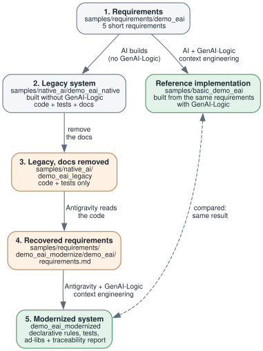
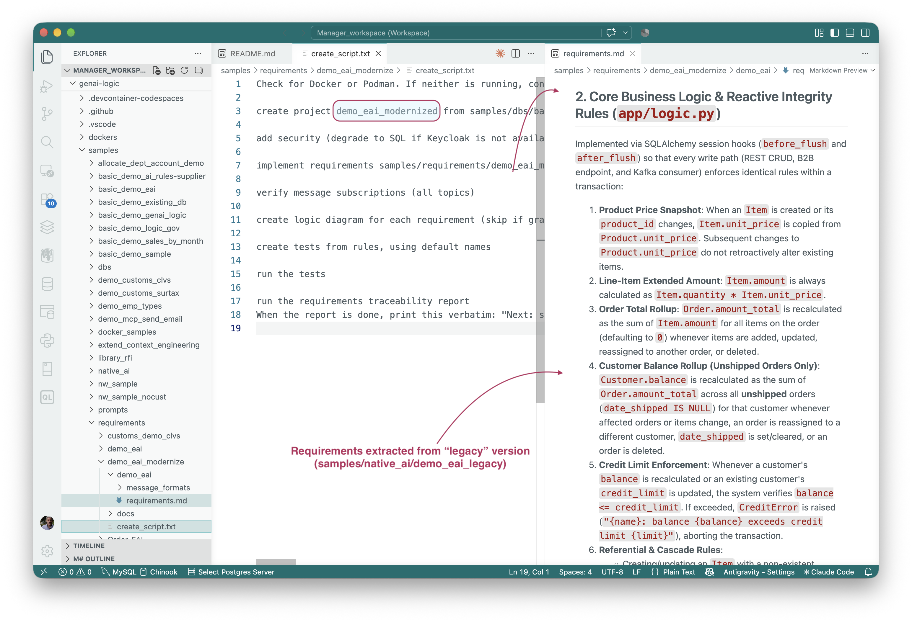

<!--
Audience: senior architects, industry analysts, dev managers.
Headline: legacy code modernized, to rules.  One sample only.
Sample projects: samples/native_ai/demo_eai_legacy and samples/native_ai/demo_eai_modernized;
the script and the recovered requirements are in samples/requirements/demo_eai_modernize.
-->

<style>
  .md-typeset h1,
  .md-content__button {
    display: none;
  }
</style>

# Legacy Code, Modernized to Rules

## The problem

Legacy systems enforce business policy, but the policy lives in the code.  The requirements are gone, or never existed, and the one person who could say what the system does has moved on (see [What Did the AI Build?](https://apilogicserver.github.io/Docs/Tech-RTP/)).

Modernizing that code usually means reading it, guessing at intent, and rewriting it into a modern architecture.  But it's still spaghetti code, and the documentation drift starts again.

Here's an approach that not only modernizes, but results in a system **governed by declarative, spreadsheet-like rules** you can **read, trust and maintain.**

&nbsp;

## The experiment

One small system, three steps.  Two AI assistants took part, Antigravity and Claude, each with GenAI-Logic's context engineering loaded.

1. We began by using the requirements from one of our standard samples: *demo_eai* (order entry with inputs from APIs and Messages).  It created the reference implementation, using GenAI-Logic.
2. **The legacy system.**  We had AI build *demo_eai* as a conventional application, with no GenAI-Logic: SQLAlchemy session hooks for the business logic, a REST API, a Kafka consumer and producer, Keycloak security.  
3. Then we removed every document.  What remained was code and tests: a legacy system.
4. **Recover the requirements from the legacy system.**  Antigravity read the code and distilled down what it does, in plain language: six sections covering the data model, the business rules, shipping notifications, B2B intake, security and the API contract.  Claude also recovered them, as a check; the two cover the same ground. [Legacy project and distilled requirements docs here](https://github.com/ApiLogicServer/ApiLogicServer-src/tree/main/api_logic_server_cli/prototypes/manager/samples/native_ai/demo_eai_legacy){:target="_blank" rel="noopener"}.
5. **Rebuild - modernized, with rules.**  From Antigravity's recovered requirements, Claude generated a new system: declarative business rules, tests, and a traceability report.  The build took about 12 minutes.  [The resultant system is here](https://github.com/ApiLogicServer/ApiLogicServer-src/tree/main/api_logic_server_cli/prototypes/manager/samples/native_ai/demo_eai_modernized){:target="_blank" rel="noopener"}, including [system-generated tests and report](https://github.com/ApiLogicServer/ApiLogicServer-src/blob/main/api_logic_server_cli/prototypes/manager/samples/native_ai/demo_eai_modernized/docs/requirements/project_creation_report.md){:target="_blank" rel="noopener"}.



*The numbers match the list above.  Orange is the legacy side, green is the modernized result.  The reference implementation is the original requirements built directly with GenAI-Logic; box 5 was compared with it.  Boxes 1 to 4 and the reference are folders under the Manager's `samples/`; box 5 is created at the Manager root and kept as a sample.*

&nbsp;

### Running step 4

Step 4 is a short script, pasted to the AI assistant.  It creates the project, then implements the requirements named on line 7, the ones recovered from the legacy code, and goes on to the tests and the report.



*Left: the creation script.  Right: the requirements it implements, recovered from `samples/native_ai/demo_eai_legacy`.*

&nbsp;

## What came out

| | Legacy | Modernized |
|---|---|---|
| **Where the policy lives** | Session hooks in `app/logic.py` | Five declarative rules in `check_credit.py` |
| **Written requirements** | None | Recovered from the code, then traced to rules |
| **Judgment calls** | Invisible | Listed in an ad-libs report: 6 items for review |
| **Evidence** | Tests | 35 of 35 scenarios passing, Kafka tested live through the broker, each scenario embedding the engine's log of the rules that ran |
| **Governance** | Read the code | A Requirements Traceability Report: each requirement beside its rules and tests |

The rules for the credit policy:

```python
Rule.copy(derive=models.Item.unit_price, from_parent=models.Product.unit_price)
Rule.formula(derive=models.Item.amount, as_expression=lambda row: row.quantity * row.unit_price)
Rule.sum(derive=models.Order.amount_total, as_sum_of=models.Item.amount)
Rule.sum(derive=models.Customer.balance, as_sum_of=models.Order.amount_total,
         where=lambda row: row.date_shipped is None)
Rule.constraint(validate=models.Customer,
                as_condition=lambda row: row.credit_limit is None or row.balance <= row.credit_limit,
                error_msg="{row.name}: balance {row.balance} exceeds credit limit {row.credit_limit}")
```

The full system has 8 rules: these 5, plus 3 Python events: the Kafka publish, the bridge for the two-step message intake, and a standard date-stamping handler.

We compared the result with a reference implementation, the original requirements built directly with GenAI-Logic.  The same tables (one column default aside), the same five credit rules (one null guard aside), and the same Kafka and security structure.

&nbsp;

## Extraction finds things

The extraction step is more than a transcription.  Reading the legacy code, it recorded behavior the original five requirements never stated, and the rebuild carried two of them over:

- **Deleting an order deletes its items.**
- **Clients cannot set derived columns.**  Values sent for a customer's balance, an order's total, or an item's amount or price are ignored.  Without this, a probe of the rebuilt system showed a client `PATCH` could overwrite a customer's balance.  The rebuild added a guard.

The extraction also noted that `Product.count_suppliers` exists in the schema, but no rule ever updates it.  The rebuild did not act on that; it needs a human decision.

Once the policy is written down as requirements, this kind of gap is visible.  In the code, it was not.

&nbsp;

## What the AI left for review

The ad-libs report lists the decisions the AI made beyond the requirements.  Three of the six open items:

- **Message timing.**  The legacy code published the shipping message after the database commit.  The rebuild publishes it after the rules run but before the commit, the platform's standard pattern.  A failed commit could leave a message already sent.
- **Who counts as sales.**  The legacy code granted the `sales` role to a configured username (default `u1`).  In the shipped Keycloak realm that user holds a different role, so the rebuild uses the roles in the token.
- **Two open routes dropped.**  The legacy `/health` and `/kafka_log` endpoints were not recreated.

A person decides each of these.  That is the point of listing them.

&nbsp;

## Why rules

Modernization has an old failure mode: the rewrite is as unreadable as the original, so the problem is renewed, not solved.  Rules are the part that changes it.  They are close to the requirement's own level, executed by an engine that fires on every commit, and the report lists each requirement beside the rules that implement it.  The next system is one you can read.

&nbsp;

## What this doesn't claim

This is one small sample, run once, by two AI assistants.  It shows what the process does, not how often, and not at scale.  The legacy system was built by AI for this experiment; a real one will have years of undocumented decisions, and the extraction step will miss some.

The recovered requirements describe what the code does, which is not always what the business meant; a human review of that document is the step that matters.  They also described how the legacy code worked (session hooks, a Flask route), and some of that wording ended up in the new rule files' docstrings.  Extraction should say what, not how.

We checked the modernized system against the recovered requirements, not against the legacy system itself.  The two are not interchangeable: the legacy REST API returns plain JSON, and the new one follows the JSON:API standard.

&nbsp;

## Conclusion

Legacy code in, readable rules out, with the requirements recovered along the way and a report that shows the work: 8 rules, 35 of 35 scenarios passing, Kafka tested live, and six decisions listed for review.  Start with the recovered requirements, then the rules in `check_credit.py`, then the ad-libs report, then the traceability report.

> **Rules are the governance**<br> - Enforcement You Can Trust<br> - Documentation You Can Read

[GenAI-Logic](https://www.genai-logic.com/) — free to use, source available.
