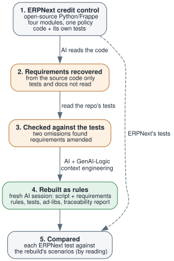

<!--
Audience: senior architects, industry analysts, dev managers.
Headline: a second modernization example, from a real open-source codebase we did not write.
Companion to Tech-Modernization-Automation.md (demo_eai).
Project: erpnext_credit_modernized (not yet a sample). The script and the recovered requirements are in
samples/requirements/erpnext_modernize.  TODO: link the project here once it is placed under samples/.
Run: 2026-10-29. Numbers are from the run log, the traceability report and the ad-libs report of that run.
-->

<style>
  .md-typeset h1,
  .md-content__button {
    display: none;
  }
</style>

# A Real Codebase, Modernized to Rules

## Why a second example

The [first modernization example](Tech-Modernization-Automation.md){:target="_blank" rel="noopener"} used a legacy system that AI wrote for the experiment.  That is a fair start, but it is cleaner than real code.

So we repeated the process on something we did not write: the credit control in ERPNext, an open-source business application (Python, on the Frappe framework).  The rule is simple to state: a customer may not take on more business than their credit limit allows.  In ERPNext it is enforced separately on Sales Orders, Delivery Notes, Sales Invoices and Journal Entries, with different bypass logic in each.

As before, the question is whether the policy can be recovered as written requirements, and rebuilt as rules you can read, trust and maintain.

TLDR: the process worked, and it surfaced its own uncertainty.  What it does not show is that the rebuilt system behaves the same as ERPNext.  See the assessment below.

&nbsp;

## The experiment

Four steps, one policy.

1. **The source.**  The credit-control slice of ERPNext: the limit lookup, the outstanding amount, the check, and the four places it runs.
2. **Recover the requirements.**  AI read the source code only.  It did not read the tests or the documentation.  It wrote the limit lookup (customer, then customer group, then company default), how outstanding is computed (ledger balance, open Sales Orders, delivered-but-not-billed), the check, and where it runs.
3. **Check against the repository's own tests.**  Afterwards we read ERPNext's tests and compared.  They agreed on every behavior they cover, and showed two omissions: reopening a closed Sales Order re-checks credit, and a customer's limits can be copied from their customer group.  Both were in files the first pass had not searched.  The requirements were amended with them.
4. **Rebuild as rules.**  A fresh AI session was given only a short script and the requirements.  It created the project, added security, implemented the requirements, drew the logic diagrams, created and ran the tests, and ran the traceability report.



*The numbers match the list above.  Orange is recovery, green is the rebuilt system.*

&nbsp;

### Running step 4

The script:

```
create project erpnext_credit_modernized from samples/dbs/starter.sqlite

add security (degrade to SQL if Keycloak is not available)

implement requirements samples/requirements/erpnext_modernize/erpnext_credit

create logic diagram for each requirement (skip if graphviz is not available)

create tests from rules, using default names

run the tests

run the requirements traceability report
```

There is no source database: the AI designed the schema from the requirements, so every table and column is a decision it made.  That is why the review list below matters.

The requirements simplify ERPNext deliberately: one ledger table instead of the accounting module, one currency, and documents entered with their totals.  The rebuild models the credit policy, not ERPNext.

&nbsp;

## What came out

The run took about 21 minutes.

|                            | ERPNext                                         | Rebuilt                                                                                           |
| -------------------------- | ----------------------------------------------- | ------------------------------------------------------------------------------------------------- |
| **Where the policy lives** | Four `check_credit_limit` methods in four modules | Four commit constraints calling one check, one limit lookup and one outstanding amount          |
| **Written requirements**   | None                                            | Recovered from the code, then traced to rules                                                     |
| **Judgment calls**         | Invisible                                       | Listed in an ad-libs report: 12 items for review, 12 notes                                        |
| **Evidence**               | A large test suite                              | 52 credit scenarios passing (53 with the scaffold's own); each ERPNext credit test in the slice has a counterpart scenario |
| **Governance**             | Read the code                                   | A Requirements Traceability Report: each requirement beside its rules and tests                   |

The full system has 32 rules: 15 declarative (sums, formulas, copies, constraints), 13 Python functions and 4 events.  The credit controller exception, where a user holding a role may exceed the limit, is one function:

```python
def _current_user_is_credit_controller(session) -> bool:
    role = models.SysConfig.current(session).credit_controller
    if not role:
        return False                                # no credit controller role set: nobody is excused
    try:
        from security.system.authorization import Security
        return Security.current_user_has_role(role)
    except Exception:
        return False                                # no signed-in user: not excused, the check is enforced
```

The AI found this through the context engineering (a section on using roles inside business rules, added after an earlier test showed it was missing).  Which role counts as the credit controller is not in the requirements.  The AI made it a configuration value, seeded it as `manager`, and listed it for review.

&nbsp;

## Extraction finds things

Reading the code, the extraction recorded things nobody had written down:

- **One flag, two meanings.**  A customer's `bypass_credit_limit_check` flag skips the check entirely on a Sales Order, but means "ignore open Sales Orders" on a Delivery Note, an Invoice and a Journal Entry.  A customer with it on is never checked at order time and is checked at delivery and invoice time.
- **A zero limit cannot override.**  A customer limit of 0 is treated as not set, so it falls through to the group limit; "no limit for this customer" cannot be expressed there.
- **Four copies of one policy.**  Changing the policy means changing four places.

Putting the policy in writing makes this visible.  In the code, it was not.

&nbsp;

## What the AI left for review

The ad-libs report lists the decisions the AI made beyond the requirements.  Some of the twelve:

- **Which role is the credit controller.**  Named in the requirements only as "a role".  Chosen as `manager` and made configurable.
- **No signed-in user.**  A seed script or a message consumer has no user; the check is enforced.
- **No record of an override.**  When a controller lets a document through, nothing records it.  ERPNext behaves the same.
- **A group limit of 0.**  The rebuild reads "first match wins" literally, so a group row with limit 0 means no limit.  ERPNext, checked afterwards, falls through to the company default.  The requirements did not say it.
- **A customer must belong to a group.**  The rebuild requires it.  ERPNext's customer definition does not mark it required.

A person decides each of these.  We did not resolve them, because the goal was to test the process, not to deploy the system.  Two of them show the review list doing its job: the AI marked the places it had guessed, and when we checked, in one the guess differed from ERPNext and in another it was stricter.

&nbsp;

## Assessment

We tried to be candid about what this run does and does not show.

**What it supports**

- **The process runs end to end on code we did not write.**  Recovery, a check against independent tests, and a blind rebuild produced a governed system in about 21 minutes.
- **The tests were useful.**  They found two extraction omissions that a read of the source had missed.
- **The review list catches real uncertainty.**  Two of its items turned out to differ from ERPNext once we looked.
- **The role-in-a-rule gap was real, and fixing it worked.**  An earlier test found the context engineering never mentioned the method; after the fix, two runs found it unaided.

**What it does not show**

- **Equivalence.**  The same AI family recovered the requirements, rebuilt the system and wrote its tests, so errors can correlate.  Fifty-three passing scenarios show the rebuild is consistent with its own requirements, not that it behaves like ERPNext.  We did not run ERPNext.  The comparison with ERPNext's tests was done by reading.
- **The whole system.**  The rebuild is a model of the credit policy.  The ledger was simplified, and tax, status derivation and billing percentages were inputs, not computed.  Those are the hard parts of ERPNext.
- **A pure extraction.**  The amended requirements include what ERPNext's tests taught us, so they are not strictly from the code alone.
- **Completeness of the reference.**  ERPNext's tests cover the main paths but miss the behaviors most likely to be real design decisions, such as the credit controller override and the exact-limit boundary.  For those we wrote scenarios ourselves; nothing from ERPNext backs them.
- **A trend.**  This is one slice, run once, and a second example beside the first.  It is also modern Python.  Moving older code to rules is a bigger step.

**Rough edges we noticed**

- The generated tests accept any error status for a rejected document; the run log reports a server error (500) where ERPNext raises a validation error.  We have not confirmed whether that is by design.
- The traceability report missed one endpoint and flagged one helper rule as untraced, because two requirement sections lacked a `Feature:` name.
- The AI read the rules engine's source for a few minutes to learn how commit constraints behave; the context engineering does not explain them yet.

**What would make it stronger**

- A second, independent recovery by a different model, rebuilt separately, then compare the two sets of requirements.
- Running the same cases through ERPNext itself and through the rebuild.  That needs an ERPNext installation, which we did not attempt.
- Repeating the run to see how much it varies.

So: encouraging and credible as a process, not yet evidence that a rebuilt system matches the original.

&nbsp;

## Why rules

Instead of modernizing Legacy-Frankencode into Modern-Frankencode, this approach results in rule-based systems you can:

* **read:** the policy is written once, not in four places
* **trust:** rules are run at commit time - every transaction source, every path, no bypass
* **maintain:** rules are self-ordering, so you can add new rules without execution-path archaeology

&nbsp;

## Conclusion

Source in, requirements recovered, rules out, with a report that shows the work: 32 rules, 52 scenarios passing, and twelve decisions listed for review.  Read the recovered requirements first, then the credit rules, then the review list.  Treat the result as a promising second data point, with the caveats above.

> **Rules are the governance**<br> - Enforcement You Can Trust<br> - Documentation You Can Read

[GenAI-Logic](https://www.genai-logic.com/) — free to use, source available.
