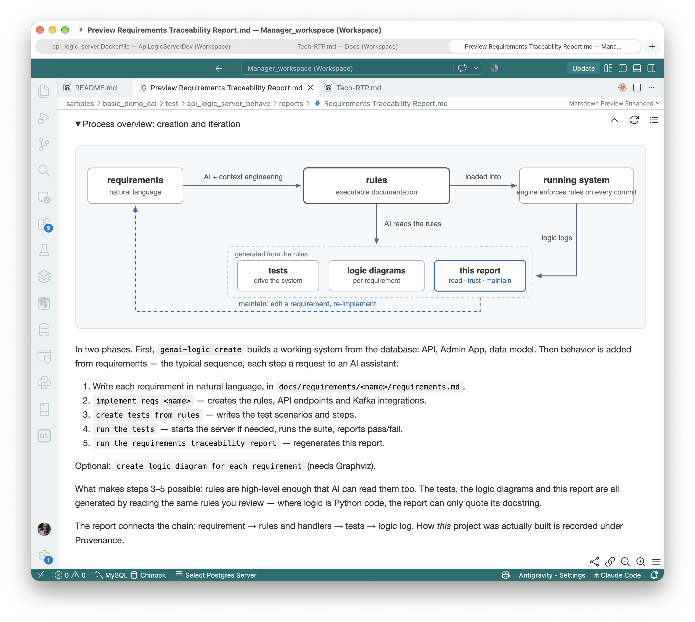
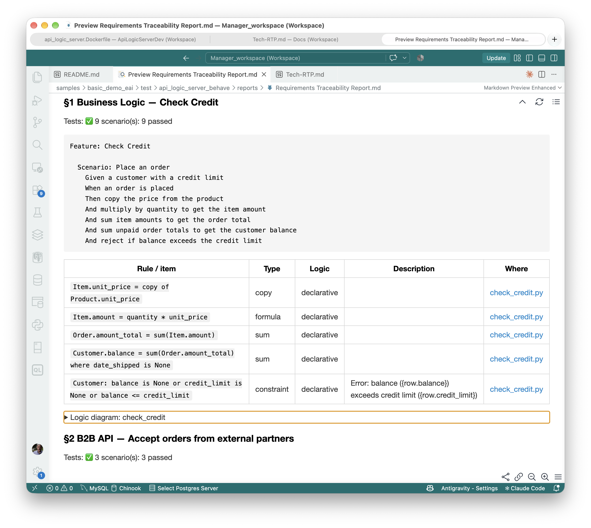
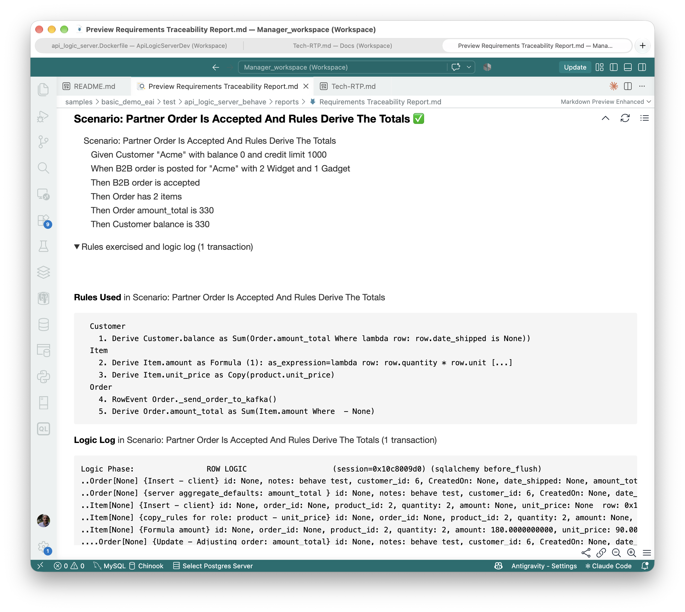

# What Did the AI Build?

## Old school: what is our business policy?

Systems exist to enforce business policy.  Of course.

But does the code match our intent?  I heard of a large company that kept a developer whose real job was reading the code to find out what the policy actually was.  The documentation was hopeless, so he *was* the documentation.  A human parser.

&nbsp;

## New school: what did AI build?

Now AI writes the code, and the experience is remarkable.  A requirement like this, in business language:

```gherkin
Feature: Check Credit

  Scenario: Place an order
    Given a customer with a credit limit
    When an order is placed
    Then copy the price from the product
    And multiply by quantity to get the item amount
    And sum item amounts to get the order total
    And sum unpaid order totals to get the customer balance
    And reject if balance exceeds the credit limit
```

becomes working business logic in a running system, with its database, API and Admin app.  As a demo, it's stunning.  (A regulation-sized prompt is more dramatic still; see [You Can't Govern What You Can't Read](Tech-Surtax.md).)

And then what we all ask: *what did AI build?*  "Unpaid orders": what does that mean in the data?  "Exceeds": does a balance equal to the limit count?  Somebody decided.

The old developer's job didn't go away; it got bigger.  The volume went up, and the author left.  Nobody wrote this code, and nobody can say what it does without reading all of it.

&nbsp;

## The standard answers break down

A governable system is one you can **read**, **trust**, and **maintain**.  That starts with a simple question: *what does the system do?*  There are two standard places to look, and both break down:

- **Requirements say too little.**  The prompt is **incomplete** by design (we *want* AI to fill in details and make assumptions) and the generation is **probabilistic**.  So the prompt can't be the source of truth, and the code can't be trusted unread, the way we trust a compiler's output.
- **Code says too much.**  Business language in, hundreds of lines of procedural code out.  That moves all the complexity from writing to reading, and generated code is more than any team can read.  Review is already being called the next bottleneck.  In an [A/B test](https://github.com/ApiLogicServer/basic_demo/blob/main/logic/procedural/declarative-vs-procedural-comparison.md), a five-line credit policy became about 200 lines of AI-generated procedural code, with two bugs in change paths it missed.

What about process: reviews, sign-offs, documentation standards?  Process governs paper.  A sign-off certifies that someone reviewed what no one could fully read, and the documents drift from the code the day they're written.  That can look like governance without governing anything.

What about better models?  Models miss things today: in one experiment, an order system silently went stale on updates and deletes ([details](Tech-Standard-Reqs.md)).  Better models should help, and we hope so.  But that doesn't address the governance issue, which is readability: a better model still generates more code than anyone will read.

The problem is the representation, not the capability.  We need something in between: not too little, not too much.

&nbsp;

## Maintain the abstraction: rules, not code

We started at a high level of abstraction — business language — and ended at a very low one.  So don't drop down.

> Train AI to translate intent into something just as high-level, but complete and deterministic: business rules, executed by an engine that handles the dependencies.

### 1. Rules

The requirement above becomes rules like this:

```python
Rule.copy(derive=models.Item.unit_price, from_parent=models.Product.unit_price)
Rule.formula(derive=models.Item.amount,
             as_expression=lambda row: row.quantity * row.unit_price)
Rule.sum(derive=models.Order.amount_total, as_sum_of=models.Item.amount)
Rule.sum(derive=models.Customer.balance, as_sum_of=models.Order.amount_total,
         where=lambda row: row.date_shipped is None)
Rule.constraint(
    validate=models.Customer,
    as_condition=lambda row: row.balance <= row.credit_limit,
    error_msg="balance ({row.balance}) exceeds credit limit ({row.credit_limit})")
```

Five rules, and the engine runs them and orders the dependencies itself.

These are *transaction* rules.  The engine listens for database commits, compares each row's old and new state, and adjusts a parent total by the change instead of re-reading the children.  It is not a RETE-style [decision engine](https://apilogicserver.github.io/Docs/FAQ-RETE/); it is built for transaction processing, and the two are complementary.  A decision engine has to be *called*, so you must audit every caller to know the logic is enforced.  Here the engine fires on every commit, so nothing can skip it.

### 2. Goldilocks: for review, rules are just right

Requirements say too little, and code says too much.  **Rules are just right** — close to the requirement's own level, but complete and deterministic.  AI fills in the details as it builds, as it should, so the requirement no longer says exactly what the system does.  The rules do.

That restores the compiler's contract: a readable source, deterministically executed.  It only works if the output is what runs.  Documentation kept beside code drifts the day it's written.  Rules are **executable documentation** that you can read and trust:

* **Read:** rules stay near the requirement's level, so a report can list them side by side and you can check one against the other.  5 rules vs. ~200 lines: **~40x less to review**, whether generated or hand-coded.  That's a small system; for what happened at scale, see [what Versata tells us](FAQ-Versata.md).
* **Trust:** the document is enforced, not just descriptive.
    * **What you read is what runs** — no drift between description and behavior.
    * **Dependencies:** with code, you analyze every execution path to know it runs at the right times.  With rules, if the rule is there, it runs, in the right order.
    * **All sources and paths:** the engine hooks every commit through the ORM — API, UI or agent — insert, update and delete, including related rows.
    * **Evidence:** each test scenario embeds the engine's log of every rule that ran, in order, with old and new values (below).

> Seeing is believing: if you see a rule, you can trust it will run, in the right order, with automatic dependency management.

Governance here is active, not just process: the engine enforces the rules on every transaction, so what you review is what is enforced.

### 3. The process

You write the requirements.  AI generates the rules from them.



The rules sit at the center, and the same rules drive both sides.  The engine runs them.  AI reads them, just as you can, and generates the tests, the logic diagrams and the report from them.  That is what **executable documentation** means: one source, so the description and the behavior can't drift apart.  Whatever appears in the rules is what to test, and the report shows which rules the tests actually exercised.

Because the rules are declared, the report can work out things a reader would otherwise have to judge: which requirement each rule serves, which columns are derived, who can do what.  Nothing is inferred from the code; the dependencies are stated.

Requirements keep changing, so iteration is where this matters.  With code, the hard part is finding where to make the change so that it always runs in the right order.  Maintenance becomes archaeology.  With rules, the engine guarantees that: you change the rule, and it runs, in the right order.

Here is a real change, on the credit example.  We edited requirement 4: the item amount is the quantity times the price, *less 10% when the quantity is 10 or more*.  We asked the AI to re-implement it and compared the logic.  One rule changed, the item amount formula; the rest of the credit rules and the Kafka rule were untouched.

Then we ran the old tests, unchanged, and regenerated the report:

> **❌ 2 requirements, all implemented; 2 tested; 10 of 11 scenarios passed, 1 FAILED**
> `expected balance 900.0, got 810.0`

An old test expected a balance of 900 for ten widgets.  The rules had done what the new requirement says (ten widgets cost 810), so the test was the thing out of date: it still encoded the old policy.  We updated it, added scenarios for the new behavior, and the report went back to passing.  A second edit, "strictly less than the credit limit", changed the credit constraint and its error message, and nothing else.

To maintain the system, you edit the requirement, re-implement, re-run the tests and regenerate the report.  The report then shows what is left uncovered: a requirement with no test, a rule with no requirement, a channel no test touches.

&nbsp;

## A governed result: read the rules

The [Requirements Traceability Report](Behave-Logic_Report-bd-eai.md) is where governance happens.  Each requirement is listed beside the rules that implement it and the tests that exercise it, so you can check one against the other:



The report is built from the project's own files, and it checks in both directions.  A requirement with no rule or no test is a gap.  So is a rule that traces to no requirement.  It also reports its own holes.  In the sample there are 5 requirements, all implemented, and 4 tested; Security has no tests, and the report says so.  Of the 8 rules, 7 ran in at least one test, and the report explains why it could not match the eighth.  Two integration channels that no test mentions are flagged.

**Trust, but verify.**  A passing test is a claim; the evidence is a record of the rules running.  Because the engine runs on every commit, it can record exactly what it did, and each test scenario includes that record:



A partner order arrives.  The unit price is copied from the product, the amount is calculated, and the order total and the customer's balance are adjusted, each line showing the old and new value.  It is the engine's own account of what happened, not the test author's.

&nbsp;

## What this doesn't claim

The report reads the declarative rules exactly.  The Kafka handlers in the sample are Python, and for those it can only quote the docstring; its own summary says so: *5 declarative, 3 Python events*.  It also says what it can't show: whether a published message reached the broker, whether an event had an effect, whether the requirements are right.  And the change described above is one run on a small example: it shows what the process does, not how often.

&nbsp;

## The point

AI will keep getting better at generating code.  That doesn't fix governance.  What does: a representation short enough to read and complete enough to trust, an architecture that enforces it, and a report that shows — requirement, rules, tests, evidence — what the AI built.

[GenAI-Logic](https://www.genai-logic.com/) — free to use, source available.  The full [generated report](Behave-Logic_Report-bd-eai.md), from a [sample app](Sample-Basic-EAI.md).
