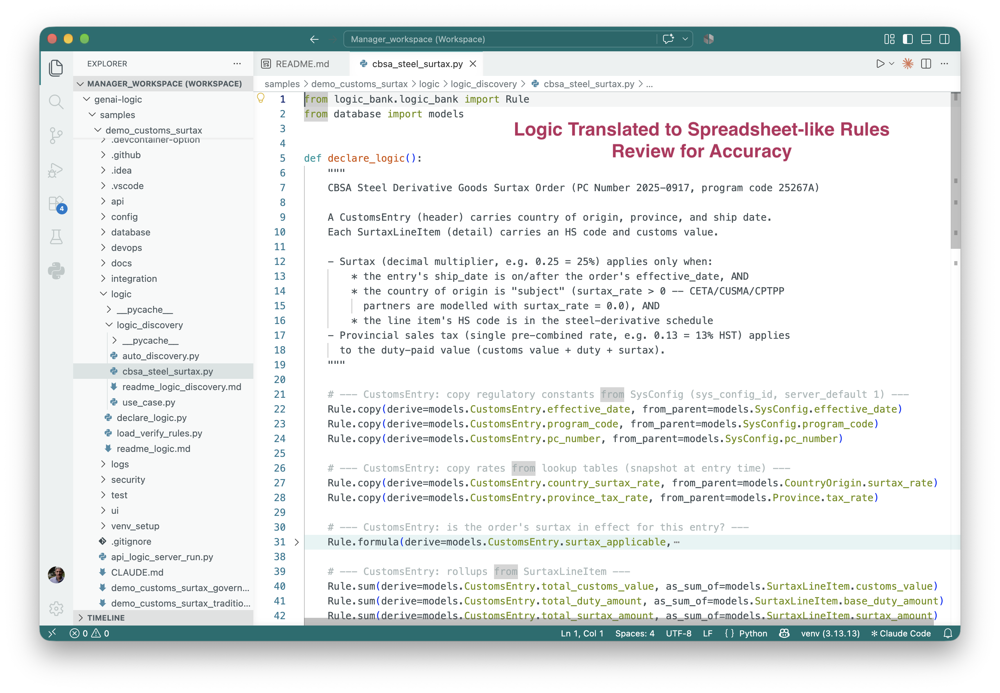
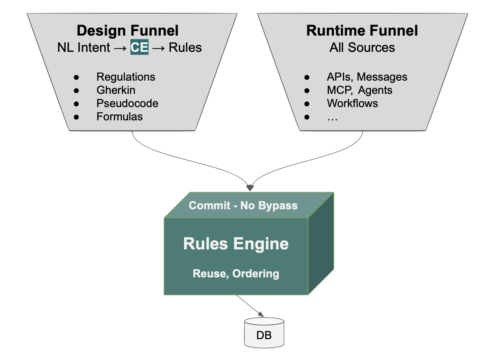

# You Can't Govern What You Can't Read

We've all had the experience: AI takes a small prompt and creates an amazing result.

Like this prompt to create a customs surtax computation:

```text
Create a fully functional application and database for CBSA Steel Derivative Goods Surtax Order PC Number: 2025-0917 on 2025-12-11 and annexed Steel Derivative Goods Surtax Order under subsection 53(2) and paragraph 79(a) of the Customs Tariff program code 25267A to calculate duties and taxes including provincial sales tax or HST where applicable when hs codes, country of origin, customs value, and province code and ship date >= '2025-12-26' and create runnable ui with examples from Germany (CETA — exempt), US (CUSMA — exempt), Japan (CPTPP — exempt), and China (subject, 25%) Transactions are received as a CustomsEntry with multiple SurtaxLineItems, one per imported product HS code.
```

It reads the regulations off the web and produces a running system, with a database, an API and a UI.  As a demo, it's stunning.

And then the quieter thought: _what_ system did we just get?

&nbsp;

We can't treat the prompt as the answer.  We _want_ AI to fill in details and make assumptions, so the prompt no longer says what the system does.

The code does.  But that moves all the complexity from the writing stage to the reading stage.

If you can't read it, you can't govern it.  That's why review is being called the next bottleneck.

&nbsp;

## The abstraction problem

We started at a very high level of abstraction, a prompt in business language.  We ended at a very low one, raw code.  There is far more code than any team can read.

&nbsp;

## A different target for AI

Suppose we train AI to translate intent into something just as high-level, but complete and deterministic.  Something we can trust.

That is business rules: spreadsheet-like expressions, executed by a runtime that handles the dependencies and chaining:



You can read this.  A compliance officer can read it, and so can the next developer.  Review becomes reading a handful of rules instead of auditing generated code.

In an A/B test on a 3-table system, AI-generated procedural code ran to about 220 lines and missed 8 change paths.  The same logic took 5 rules, and the engine covered all 9 paths.  See the [A/B test](https://github.com/ApiLogicServer/basic_demo/blob/main/logic/procedural/declarative-vs-procedural-comparison.md).  That's a ~40x reduction in what you have to review and understand.

In addition to the size, rules automate depenndencies.  With code, you have to analyze all the execution paths to understand whether it called at all the right times.  Like spreadsheets, rules guarantee: if the rule is there, it will be called, and in the right order.

&nbsp;

## Trust comes from the architecture

Readable isn't enough.  We need an architecture that steers AI to rules, and executes them.



At design time, we've trained AI to translate your intent into rules, not code, for you to review.  We do this with extensive context engineering used at creation time, part of every project.

At runtime, you also need to know the rules can't be bypassed.  The rules engine hooks into ORM commit events, so it governs every transaction source that commits through the ORM, whether it comes from the API, the UI or an agent.  No bypass.

Every path: insert, update and delete, including changes to related rows.

The result: logic you can read and trust.

&nbsp;

## The point

AI will keep getting better at generating code.  That doesn't fix governance, because the problem is the representation, not the capability.  Governance needs two things: a form of intent that is short enough to read and complete enough to trust, and an architecture that produces it and enforces it.

This is a [sample app](https://apilogicserver.github.io/Docs/Customs-readme-surtax/) for [GenAI-Logic](https://www.genai-logic.com/) - free and open source.